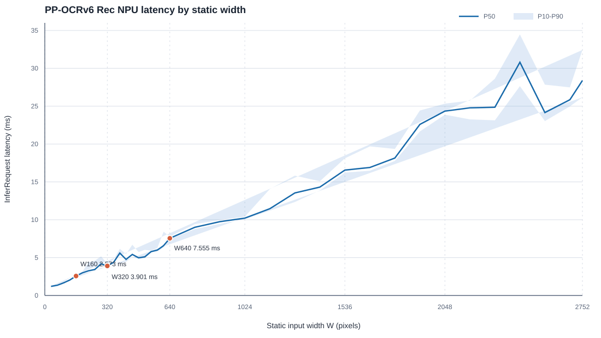

# PP-OCRv6 on Intel NPU (Level Zero Native C++)

专为 **Intel Core Ultra（Arrow Lake / Meteor Lake）NPU 硬件架构** 深度定制的高性能 PP-OCRv6 纯血 C++ 推理引擎与离线模型优化流水线。

结合 Intel Level Zero 原生运行时、统一共享内存（USM 零拷贝）、Windows 原生 WIC 解码器与大图切片概率图拼接，实现低搬运开销的 NPU 推理。

---

## 🌟 核心特性

- **纯血 C++ 交付（零 Python 依赖）**：编译产物为单一轻量 `.exe`，运行时仅依赖 Windows 系统动态库与 Level Zero 原生 NPU 驱动。
- **全格式原生解码与剪切板直读（零第三方图像库）**：抛弃 stb_image / OpenCV，直接调用 Windows 内置 **WIC（Windows Imaging Component）** 硬件解码流水线，支持 JPG, PNG, BMP, TIFF, WebP；支持通过 `--clipboard` 直接提取系统剪切板截图识别。
- **Level Zero USM 零拷贝（Zero-Copy）**：通过 `zeMemAllocShared` 分配统一内存，输入图像原地填充，NPU 原地直读，彻底消灭主机到加速器的物理拷贝开销。
- **2-请求 CPU-NPU 异步双缓冲流水线（Ping-Pong Pipeline）**：在 NPU 完整推理请求仍串行执行的前提下，让主机侧的裁剪、归一化与 CTC 解码和 NPU 执行重叠，填补 CPU-NPU 之间的流水气泡；单行均摊吞吐量达到 **475 FPS（短文本桶高达 581 FPS）**。
- **默认 960 整图检测**：按比例缩放输入，使长边不超过 960，再送入 `960×960` Det 图；可用 `--det-mode tile --tile-size <n>` 切换为固定尺寸 tile 检测。
- **概率图 tile 拼接**：显式 tile 模式的重叠区域采用逐像素 `max`，并可用 `--det-heatmap-dir` 导出每个 tile 与拼接热力图；切片边界与后处理仍需单独评估。
- **识别静态桶路由**：按文本框归一化后的自然宽度选择静态 Rec 图；桶宽必须同时满足像素宽度和 CTC 时间步容量，当前 `160/320/640` 仅是历史基线，不代表最终桶配置。
- **端到端微秒级性能剖析（`--profile` 开关）**：内建全链路各阶段高精度打点器，清晰打印图像解码、切片提取、Det 推理、DBNet 后处理、Rec 推理及 CTC 解码的耗时账单。

---

## 📊 硬件基准实测（Intel Core Ultra 9 275HX + NPU3720）

| 模块与策略 | 输入规格 | NPU 驱动显存 | **推理耗时** | 吞吐率 | 准确率 / F1 |
| :--- | :---: | :---: | :---: | :---: | :---: |
| **文本识别 (Rec) - 超速短词桶** | `48×160` | 11.8 MB | **1.72 ms** (均摊) | **581.0 FPS** | 76.00% (满血对齐 CPU) |
| **文本识别 (Rec) - 通用标准桶** | `48×320` | 12.5 MB | **2.10 ms** (均摊) | **475.1 FPS** | 76.00% (满血对齐 CPU) |
| **文本识别 (Rec) - 长句兜底桶** | `48×640` | 14.2 MB | **4.43 ms** (均摊) | 225.7 FPS | 76.00% (满血对齐 CPU) |
| **文本检测 (Det) - 默认整图缩放** | 原图长边缩至 ≤960；`960×960` 图 | 146.6 MB | 随有效输入尺寸变化；`960×960` 实测 36.1 ms | 随输入变化 | `02.png` 对照检出 18 行 |
| **文本检测 (Det) - 历史 640 tile 基准** | `640×640` | 65.8 MB | **15.87 ms** | 62.0 FPS | 31.2% (历史验证集) |
| **大图检测 (1080p) - tile 拼接** | $1920 \times 1080$ | 65.8 MB | 取决于 tile 数 | 取决于 tile 数 | 原图像素保留，但需验证边界效果 |

上述 Rec 延迟和 `160/320/640` 桶是历史基线微基准，不是跨数据源的最终桶结论；真实 Rec 裁剪、文档整行和屏幕截图的自然宽度分布见下文。

> 详细消融实验分析、硬件 FTZ NaN 根因排查与微架构报告请见：[`docs/npu_optimization_report.md`](docs/npu_optimization_report.md)。

---

## 🛠️ 环境依赖与前置准备

1. **操作系统**：Windows 11 / Windows 10 (x64)
2. **NPU 驱动**：Intel NPU 驱动 `32.0.100.5540` 或更新版本（任务管理器中可见“Intel AI Boost”）
3. **C++ 编译器**：Visual Studio 2022 (MSVC v143, 支持 C++17) & CMake 3.24+
4. **Level Zero SDK**：安装至 `C:\Program Files\LevelZeroSDK\1.32.0`（或设置环境变量 `LEVEL_ZERO_V1_SDK_PATH`）
5. **Python 环境（用于模型转换与评测）**：安装现代包管理器 `uv`（`pip install uv` 或 `winget install astral-sh.uv`）

---

## 🚀 快速上手

### 1. 使用 uv 初始化环境并构建优化模型

通过 `uv` 自动化配置虚拟环境并生成全部 NPU 优化资产（IR、NGRAPH_LITE 容器与硬件 Blob）：

```powershell
# 1. 自动同步依赖环境
uv sync

# 2. 构建默认 GELU Det 960x960 与 Rec 160/320/640 优化 IR 模型及词表
uv run python scripts/build_models.py
```

构建完成后，`models/` 目录下将生成轻量级 IR 资产：
- `ppocrv6_small_det_960x960.xml` / `.bin` / `.ngraph_lite`
- `ppocrv6_small_rec_w160.xml` / `.bin` / `.ngraph_lite`
- `ppocrv6_small_rec_w320.xml` / `.bin` / `.ngraph_lite`
- `ppocrv6_small_rec_w640.xml` / `.bin` / `.ngraph_lite`
- `ppocr_keys_v1.txt`（包含 18,709 个字符的完整多语种字典）

> **注**：无需手动存放硬件二进制 Blob。首次运行 C++ 引擎时，驱动将自动执行 JIT 编译并缓存至 `cache/<model_name>.blob`，后续运行 0.2ms 自动秒开。

---

### 2. 编译 C++ 原生推理引擎

```powershell
# 创建构建目录并生成 VS2022 解决方案
cmake -B build -G "Visual Studio 17 2022" -A x64

# 编译 Release 版本
cmake --build build --config Release
```
编译产物位于：`build/Release/ppocr_npu.exe`。

---

### 3. 运行推理与命令行使用指南

#### 场景 A：从剪切板秒级识别截图（最常用功能）
按下 `Win + Shift + S` 截图后，直接在终端执行：
```powershell
.\build\Release\ppocr_npu.exe --clipboard --profile
```

#### 场景 B：指定本地图片文件进行识别
```powershell
.\build\Release\ppocr_npu.exe --image test_invoice.jpg --profile
```

#### 场景 C：高清大图（如 1080p / 2K）切片拼接识别
```powershell
.\build\Release\ppocr_npu.exe --image doc_1080p.png --det-mode tile --tile-size 640 --profile
```

---

## 📋 命令行参数详解

| 参数项 | 说明 | 默认值 |
| :--- | :--- | :--- |
| `--image <path>` | 指定输入的本地图像路径（支持 JPG, PNG, BMP, TIFF, WebP） | 空 |
| `--clipboard` | 直接从 Windows 系统剪切板捕获图像（CF_DIB 原生直读） | `false` |
| `--det-model <path>` | 文本检测模型路径（支持 `.xml`, `.ngraph_lite` 或 `.blob`） | `models/ppocrv6_small_det_template.xml` |
| `--det-mode <mode>` | 检测模式：`resize` 整图缩放或 `tile` 固定尺寸检测 | `resize` |
| `--tile-size <n>` | `tile` 模式的 tile 边长；仅图像超过该尺寸时拆成多个 tile（32 到 960，且为 32 的倍数） | `960` |
| `--det-relu-mul7` | 可选地将 Det `Mul.7` 的 GELU 替换为 ReLU（非等价变换，仅 640 图） | `false` |
| `--rec-model-160 <path>` | 短词识别模型路径 ($W=160$)，默认从模板填充形状 | `models/ppocrv6_small_rec_template.xml` |
| `--rec-model-320 <path>` | 标准识别模型路径 ($W=320$)，默认从模板填充形状 | `models/ppocrv6_small_rec_template.xml` |
| `--rec-model-640 <path>` | 长句识别模型路径 ($W=640$)，默认从模板填充形状 | `models/ppocrv6_small_rec_template.xml` |
| `--dictionary <path>` | 字符映射字典文件路径 | `models/ppocr_keys_v1.txt` |
| `--rec-scheduling <mode>` | 识别请求调度：`round-robin` 固定轮转或 `poll` 轮询已完成请求；`poll` 仅支持在途数为 2 | `round-robin` |
| `--rec-inflight <n>` | 每个识别模型同时在途的请求数（1 到 8）；使用 `poll` 时必须为 2 | `2` |
| `--graph-format <name>` | XML 模型编译格式：`ngraph-lite` 或 `native-blob`；动态形状模板只支持 `ngraph-lite` | `ngraph-lite` |
| `--cache-backend <name>` | 编译缓存：`app` 项目缓存或 `driver` 驱动磁盘缓存 | `app` |
| `--npu-low-latency` | 请求低延迟命令队列（功耗较高） | `false` |
| `--profile` | 输出端到端各阶段耗时与吞吐报告 | `false` |
| `--trace <path>` | 导出主机阶段和 NPU DPU/SHAVE/DMA task 的 Chrome Trace JSON，含 NPU 空档 | 关闭 |
| `--trace-mode timestamps` | 只导出 command timestamp 时间窗，不启用 task-level profiling；需同时指定 `--trace` | `tasks` |
| `--trace-raw-dir <path>` | 额外导出 RAW profiling buffer、profiling graph blob 和设备时钟采样（诊断用）；不能与 `--trace-mode timestamps` 同用 | 关闭 |
| `--det-heatmap-dir <path>` | 导出每个检测 tile 的概率热力图及最终拼接图（PGM，后处理前；诊断用） | 关闭 |
| `--cache-stats` | 查询并打印驱动/program cache 统计（诊断查询，可能较慢） | `false` |

### 检测缩放与切片规则

默认 `--det-mode resize` 将整图等比例缩放，使长边不超过 960（不放大），再填入 `960×960` 输入图。使用 `--det-mode tile` 切换到固定尺寸检测，并可用 `--tile-size N` 指定桶宽；图像宽高都不超过桶宽时单次推理，不拆 tile。超过桶宽时，切片数量和起点按以下规则计算：

```text
min_overlap = min(80, tile_size / 2)
effective_step = tile_size - min_overlap
n = ceil((image_size - min_overlap) / effective_step)
step = (image_size - tile_size) / (n - 1)   # n > 1 时均匀铺满首尾
```

`min_overlap` 是布局计算使用的重叠下限；首尾均匀对齐后，实际重叠可以更大。以默认 640 tile 的 `1279×1710` 为例，实际起点为：

```text
X: 0, 320, 639       -> 重叠 320/321 px
Y: 0, 535, 1070      -> 重叠 105 px
```

每个 tile 的概率图映射回原图后，重叠像素执行逐元素 `max`，不做平均或线性羽化。使用 `--det-heatmap-dir <dir>` 可导出 `det-tile-*.pgm` 和最终 `detector-heatmap.pgm`。

概率图 tile 拼接与官方 PaddleOCR 的默认行为不同：官方默认是将整图等比例缩放，使长边不超过 960，再执行一次 DET；C# 参考实现也是动态 reshape 到实际尺寸（例如本图 `704×960`），不补成 `960×960`。官方的显式 `slice=` 是另一条可选路径，按 slice 独立检测、框坐标回加后再合并，不是本项目的概率图 `max` 拼接。

对 `Z:\TrustedSpace\02.png` 的实测为：`--det-mode tile --tile-size 640` 检出 17 行，默认 960 整图缩放检出 18 行，SimdPaddleOCR 默认 960 缩放也检出 18 行。这个结果证明两条路径行为不同，但不能单独证明 tile 接缝是唯一根因；当前 C++ DBNet 后处理也与官方实现不同。

### Rec 自然宽度分布

Rec 路由使用裁剪框在高度 48 px 下的自然宽度。不同数据源分布差异很大：

| 数据源 | 样本数 | P50 | P90 | 最大 | `<=160` | `<=320` | `>640` |
|---|---:|---:|---:|---:|---:|---:|---:|
| 合成文档整行 | 1036 | 509 | 1634 | 2727 | 0% | 12.2% | 35.1% |
| PaddleX Rec 裁剪 | 6545 | 95 | 167 | 438 | 88.1% | 99.7% | 0% |
| PP-OCRv5 Rec 裁剪 | 111 | 97 | 182 | 287 | 82.9% | 100% | 0% |
| 截图 `01.png` | 65 | 369 | 1313 | 1604 | 26.2% | 44.6% | 35.4% |
| 截图 `02.png` | 18 | 328 | 464 | 495 | 11.1% | 44.4% | 0% |

像素宽度还不是唯一约束。Rec 的 CTC 时间步为 `T=W/8`，例如 `W96/128/160` 分别只有 12/16/20 步；PaddleX 验证集里，字符数超过这些容量的比例分别为 0.58%、0.10%、0.05%。因此桶选择必须同时检查自然宽度和字符容量，不能把 `W160` 当固定短桶起点，也不能仅凭像素分布决定最终配置。

完整的 `W32..W2752` NPU 宽度曲线已记录在优化报告。该曲线使用每宽度独立进程、编译后按墙钟预热 2 秒、再采样 30 次的协议；曲线总体随宽度增长，但受 compiler shape/tiling 和 DVFS 影响存在局部台阶与离散。当前 C++ 的 `W>640` 仍走 W640 滑窗，宽静态图测试不能直接当作现有端到端延迟。



---

## 📈 端到端 Profile 输出样例（`--profile`）

```text
============================================================
                 OCR Recognition Results                    
============================================================
[ 1] Conf: 0.98 | Box: [(310,104), (418,216)] | Text: MASA
[ 2] Conf: 0.96 | Box: [(52,340), (218,382)]  | Text: 中国工商银行
[ 3] Conf: 0.99 | Box: [(412,420), (620,464)] | Text: 增值税普通发票
============================================================

============================================================
          End-to-End Inference Profiling Metrics           
============================================================
  End-to-end additive ledger (ms)
    Image acquisition / WIC decode   :    1.25
    NPU runtime initialization      :    3.00
    NPU model/request load           :    5.50
    Dictionary load                  :    0.45
    Post-load OCR pipeline           :   16.00
    Other / inter-stage time         :    1.00
    Total end-to-end                 :   27.20 ms
  Model load detail (included in model/request load)
    Detection graph load             :    2.00 ms
    Recognition graphs load          :    3.50 ms
------------------------------------------------------------
  Post-load additive ledger (ms; sums to post-load pipeline)
    Tile extraction/preparation      :    0.84
    Detection stage wall             :    8.10
    DBNet polygon extraction         :    2.10
    Recognition pipeline wall        :    4.20
    Other / uninstrumented work      :    0.76
    Post-load OCR pipeline            :   16.00 ms
  Detailed timers (diagnostic; do not sum with their enclosing wall timers)
    Det resize/normalize             :    0.32 ms
    Det submission/wait wall         :    7.45 ms (avg 7.45 ms/tile)
    Det output FP16 decode/copy      :    0.33 ms
    DBNet polygon extraction         :    2.10 ms (3 boxes)
    Text crop/perspective warp       :    0.31 ms
    Rec padding/copy                 :    0.08 ms
    Rec normalize                    :    0.22 ms
    Rec submit                       :    0.60 ms
    Rec wait                         :    2.61 ms
    Recognition pipeline wall        :    4.20 ms (includes recognition detail above)
    CTC greedy decoding              :    0.12 ms
------------------------------------------------------------
  Page Throughput                    :   36.76 FPS
  Recognition Pipeline Throughput    :  714.29 lines/sec
============================================================
```

The two additive ledgers reconcile to their wall times. Graph-load detail is included in the model/request total; detailed detection and recognition timers are diagnostics and can overlap their enclosing stage-wall timers.

---

### NPU 流水线 Trace

```powershell
build\Release\ppocr_npu.exe --image <image> --npu-low-latency --trace Z:\TEMP\ppocr-trace.json
```

在 Perfetto UI 或 Chrome Trace Viewer 中打开导出的 JSON。默认 `--trace-mode tasks` 使用 `ZE_GRAPH_PROFILING_TASK_LEVEL` 返回的 DPU/SHAVE/DMA 事件作为请求内 task 细节；`--trace-mode timestamps` 只导出 command timestamp，不启用 task-level profiling。两种模式都会在每个 command list 前后写入 Level Zero device timestamp 作为跨请求锚点，再用 `zeDeviceGetGlobalTimestamps` 样本将 device tick 映射到主机 `steady_clock`。JSON 根对象会标出 `timeDomain=host-steady-calibrated`、`npuTaskAnchor=command-before-device-timestamp`，并额外导出 `NPU Command Window`（command-before 到 command-after）和 `NPU Queue Wait` 轨道，因此可以区分设备执行窗口、提交后排队和窗口内未覆盖区间。主 Trace 不读取 RAW profiling buffer；RAW 仅通过单独的 `--trace-raw-dir` 诊断路径导出，用于验证计时器和驱动解码。`NPU Bubble` 表示统一时间轴中没有 TASK_LEVEL 事件覆盖的区间，不等同于已证明的硬件空闲。`Profiler overhead` 轨道标出创建/读取 task query 的时间，这些测量开销也可能扰动计时。任务模式会启用图 profiling、绕过项目自己的 native blob cache，并可能触发驱动 JIT，首轮会明显变慢；采样也不应用于报告原始推理延迟。不指定时没有 profiling query 开销。

---

## 🔬 执行精度与性能评测

使用附带的自动化脚本评测检测 F1、识别准确率及异步流水吞吐：

```powershell
uv run python scripts/evaluate.py --models-dir models/ --output-json benchmark_results.json
```

---

## 📄 License

本项目基于 Apache 2.0 许可证开源。模型权重归属百度飞桨 PaddleOCR 团队所有。
