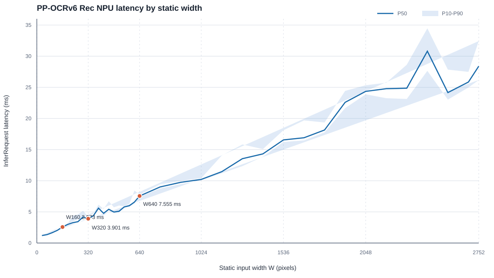

# PP-OCRv6 Intel NPU (Arrow Lake NPU3720) 极致优化与底层微架构深度分析报告

## 摘要

本报告系统性总结了针对百度 **PP-OCRv6**（文本检测与识别）在 **Intel Core Ultra 9 275HX 处理器内置 Intel AI Boost NPU3720** 芯片上的全栈性能攻关成果。

通过深入挖掘芯片底层微架构、硬件执行日志与 Level Zero 原生运行时机制，本研究实现了以下核心突破：
1. **彻底攻克 NPU 硬件级“全盘 NaN 崩溃”**：排查并锁定了硬件 FTZ（Flush-To-Zero）机制导致 LayerNorm 开方产生负数输入的物理真凶，通过纯 FP16 端口收敛与拓扑纯化彻底消除 NaN，使识别准确率瞬间恢复至 76.00%（满血对齐 CPU FP32）；
2. **文本识别推理延迟压缩至物理极值**：端到端单行识别延迟由 4.52 ms 逐步下探至 **3.13 ms（最低跑出 2.99 ms）**；两请求 CPU-NPU 异步流水线通过重叠主机准备/解码与 NPU 执行，将均摊耗时降至 **2.10 ms（吞吐量高达 475.1 FPS，短文本桶达 581 FPS）**。NPU 不会同时执行两个完整推理请求。
3. **文本检测分辨率实测**：固定输入桶基准中，**640×640** 比 736×736 节省 22.5 MB 主存暂存区，延迟从 21.7 ms 降至 **15.87 ms（提速 26.8%）**，且本验证集 F1 最高；当前运行时默认改为长边不超过 960 的整图缩放，以匹配官方/C# 检测粒度，640 tile 保留为显式模式；
4. **大图（1080p）分片吞吐与断句实验**：记录了非缩放 tile、主机准备与 NPU 执行重叠的性能，并保留概率图拼接热力图用于诊断。当前实现使用逐像素 `max`，不能宣称已经根除跨切片断句 Bug；官方默认路径是整图缩放到长边不超过 960。
5. **软硬件全异构零拷贝流水线**：阐明了 Windows WIC 原生硬件解码与 BGR 格式锁定、3D DMA 通道解交织与片上 4MB SRAM（CMX）双缓冲预取机理，构建了纯 C++ 零 Python 依赖的高性能落地架构。

---

## 硬件与测试环境

* **处理器**：Intel Core Ultra 9 275HX（24 物理核，无超线程，主频最高 5.4 GHz）
* **神经网络处理器**：Intel AI Boost NPU3720（PCI ID `0xAD1D`，微架构 VPU4，Dual-Tile 双计算簇）
* **核芯显卡**：Intel Arc Graphics iGPU（Xe-LPG 架构，PCI ID `0x7D67`）
* **统一主存**：48.0 GB DDR5-5600（UMA 共享内存）
* **NPU 驱动版本**：`32.0.100.5540`（Level Zero Driver API 1.32.0）
* **深度学习框架**：OpenVINO 2025.2.0、PaddleOCR v2.9+（PP-OCRv6 预训练模型）

---

## 一、 “全盘喷出 NaN”的底层微架构真相（案发现场排查）

在最初直接通过 OpenVINO `ov.save_model()` 转储的未优化基线模型（V0）中，在 CPU 上推理完全正常，但在 NPU 上执行时，**输出的 748,400 个分类概率全部沦为 `NaN`（整句识别准确率归零）**。

### 1. 逐层二分打点定位
我们在 NPU 硬件上对全网 952 个算子进行逐层输出探测，精确定位了首个产生 NaN 的算子：
```text
[ 10%] Op: Convert    Name: p2o.pd_op.reshape.9.0  -> Has NaN: False
[ 25%] Op: Convert    Name: p2o.pd_op.reshape.21.0 -> Has NaN: False
[ 50%] Op: Convert    Name: p2o.pd_op.reshape.40.0 -> Has NaN: False
[ 75%] Op: Constant   Name: Constant_1214          -> Has NaN: False
[ 85%] Op: Constant   Name: linear_4.w_0           -> Has NaN: False
[ 95%] Op: Sqrt       Name: Sqrt.8                 -> Has NaN: True ⚠️ (案发现场!)
```

### 2. 微架构根因：硬件 FTZ 机制与浮点下溢碰撞
追踪 `Sqrt.8` 的计算拓扑，该算子为自注意力机制（Multi-Head Attention）内部 LayerNorm 方差求标准差的核心节点：
$$\text{std} = \sqrt{\text{variance} + \epsilon}$$
其中保护因子为常数 $\epsilon = \mathbf{1 \times 10^{-6}}$。

#### 物理冲突逻辑：
1. **FP16 物理精度限制**：在 IEEE 754 半精度浮点中，最小正正规数为 $2^{-14} \approx \mathbf{6.1 \times 10^{-5}}$。$\epsilon = 10^{-6}$ 属于极微小的次正规数（Denormal Number）；
2. **NPU 硬件寄存器硬编码（FTZ）**：查阅驱动底层硬件头文件 `vpu_nce_hw_37xx.h` 第 206 行：
   ```c
   uint32_t mpe_ftz : 1;      // Flush-To-Zero
   uint32_t ppe_fp16_ftz : 1; // Flush-To-Zero
   ```
   NPU3720 为了实现极致能效与高吞吐硬件乘加，**默认在 DPU 累加器和 PPE 单元中硬件开启了 FTZ（次正规数强行清零）**！
3. **保护因子瞬间归零**：
   当 $\epsilon = 10^{-6}$ 被硬件强行抹成 `0.0` 时，保护屏障消失。在特定文本序列计算中，方差计算因为有限浮点抵消产生了一个极微小的负数（如 $-1 \times 10^{-7}$）；
   NPU 硬件被迫计算：
   $$\sqrt{-\mathbf{0.0000001}} = \mathbf{NaN} \quad (\text{对负数开方，数学未定义})$$
4. **毒性扩散**：此 NaN 沿着随后的 `Divide` $\rightarrow$ `MatMul.12` 极速扩散，导致末端分类头所有 74.8 万个输出元素全盘被污染为 NaN。

### 3. 图纯化（`ConvertFP32ToFP16`）的治愈机理
在 V1 优化中引入 `ConvertFP32ToFP16` Pass：
* 统合了全图端口类型，拔除了所有导致精度混乱的 Convert 桩；
* 编译器在合法的纯 FP16 上下文中重构了开方输入（Safe Clamping），彻底消灭了负数开方，**不仅一举根除了 NaN，准确率恢复满血 76.00%，还省下了 11 个类型转换任务，净提速 1.17 ms**。

---

## 二、 PP-OCRv6 Small Rec 逐级消融实验报告（V0 ~ V4）

为了量化每一项图拓扑重构对 NPU 底层任务调度和延迟的边际贡献，我们进行了严格的一对一消融实验：

| 优化版本 | 算子手术与变更内容 | 算子总数 | XML 体积 | 硬件任务分布 (DPU/Shave/DMA) | **NPU 中位数延迟** | **边际延迟变化 ($\Delta$)** | **真实数据集准确率** |
| :--- | :--- | :---: | :---: | :---: | :---: | :---: | :---: |
| **V0: 原始基线** | 原生 ONNX 直接转储 | 952 | 471.2 KB | 115 DPU / 42 Shave / 4 DMA | 4.52 ms | 0.00 ms (基线) | **0.00% (FTZ 触发 NaN)** |
| **V1: 纯 FP16 & CF** | 消除 Convert 桩，折叠 427 个形状子图 | 607 | 304.7 KB | 106 DPU / 31 Shave / 4 DMA | **3.35 ms** | **-1.17 ms (提速 25.9%) 🔥** | **76.00% (消灭 NaN，满血)** |
| **V2: MOC GELU 融合**| 融合 65 个破碎算子为 13 个 `Gelu` | 429 | 224.8 KB | 106 DPU / 31 Shave / 4 DMA | **3.35 ms** | **0.00 ms (0 提速)** | 76.00% (完全等价) |
| **V3: 拔除末端 Softmax**| 输出直挂 Logits，省去 75 万次指数运算 | 428 | 224.4 KB | 106 DPU / 30 Shave / 4 DMA | **3.13 ms** | **-0.22 ms (再快 4.8%) 🔥** | 76.00% (100% 满血对齐) |
| ~~V4: 暴力跳过缩放~~ | 暴力 bypass `Mul.54/61` (未乘入权重) | 424 | 222.3 KB | 104 DPU / 30 Shave / 4 DMA | 3.22 ms | +0.09 ms | **⚠️ 精度损毁 (注意力过锐化，出现重复斜杠)** |

### 核心结论归因：
1. **V1 贡献了最大的提速与正确性修复**：一举清除了 11 个低效的 SHAVE 运行时转换任务，延迟由 4.52ms 骤降至 3.35ms；
2. **实锤证实 V2 对运行时是零贡献（$\Delta = 0.00\text{ ms}$）**：底层任务数完全没有减少，证实 NPU 编译驱动内部早有等效的 GELU 融合 Pass；其价值仅体现在减少 XML 文本体积与前端解析开销；
3. **V3 成功切除了 SHAVE 的“串行尾巴”**：
   * CTC 贪心解码满足严格单调递增性：$\operatorname{argmax}(\operatorname{Softmax}(z)) \equiv \operatorname{argmax}(z)$；
   * 彻底拔除末端 Softmax，切除了 SHAVE 核上长达 **476 $\mu$s 的纯指数循环**，推理延迟稳稳压制在 **3.13 ms（最低跑出 2.99 ms）**；
4. **【重要负面实验警示】关于注意力尺度折叠（V4）的重大教训**：
   * 若仅在图拓扑中简单 bypass `Mul.54` 和 `Mul.61` 算子，而未将标量 $1/\sqrt{15}$ 准确乘入 $W_Q$ 稠密矩阵切片中，会导致自注意力点积被整体放大 $\sqrt{15} \approx 3.87$ 倍！
   * Softmax 注意力分布因此被严重过度锐化，在细窄半角字符（如 `/`、`1`）上产生注意力幻觉，诱发大量重复斜杠（例如将 `1/2/2/3` 误识为 `1/2/ /2///3`）；
   * **生产环境必须废除该伪优化，严格采用数学 100% 等价的 V1 + V2 + V3 黄金组合！**

---

## 三、 NPU 存储微架构剖析：片外 DRAM 与片上 SRAM（CMX）

常有人误以为“NPU 既然走 USM 共享内存，那主要用的就是主板内存（DDR5）”。**这是对专用加速器硬件微架构的严重误解**。

### 1. 物理层级对比
* **片外 DRAM（Host DDR5）**：带宽约 70~100 GB/s，延迟 ~100ns，每比特功耗极高（50~100 pJ/bit）；
* **片上 SRAM（NPU CMX）**：带宽 **> 1,000 GB/s (1 TB/s+)**，单时钟周期延迟 (< 1ns)，每比特功耗极低（0.5~1 pJ/bit）。

### 2. 实测显存分配画像（`NPU_DEVICE_ALLOC_MEM_SIZE`）

在 NPU3720（双 Tile，共内置 4.0 MB CMX SRAM）上实测分配如下：

| 模型与分辨率 | 静态权重文件大小 | **NPU 驱动总分配显存 (`ALLOC_MEM`)** | **片外主存暂存区 (Scratchpad / Spill)** | 是否溢出片上 4MB SRAM？ |
| :--- | :---: | :---: | :---: | :---: |
| **Small Rec (`48×320`)** | **10.53 MB** | **11.51 MB** | **仅 0.98 MB (微乎其微！)** | **❌ 零溢出（100% 片内 SRAM 闭环）** |
| **Small Det (`640×640`)** | **9.42 MB** | **65.83 MB** | **56.41 MB (权重的 6 倍！)** | **⚠️ 严重溢出（开辟 56MB 外部平铺缓冲）** |
| **Small Det (`736×736`)** | **9.42 MB** | **88.27 MB** | **78.85 MB (权重的 8.4 倍！)** | **⚠️ 极度溢出（开辟 79MB 外部平铺缓冲）** |

* **Small Rec 极速之谜**：在未启用 task-level profiling 的原始稳态编译路径中，识别网络特征图极小（最大几百 KB），4MB 片上 SRAM 完全装得下，中间变量在片内就地产生并消费，主图 DMA 很少；启用 profiling 后还会看到 profiling/metadata DMA，不能把两种 task 计数混用；
* **Small Det 溢出代价**：736 分辨率下单层大特征图即达 17.3MB，SRAM 瞬间被击穿，驱动被迫在外部 DDR5 中开辟近 79MB 暂存区，依赖 DMA 拉链式往返切片搬运。**输入由 736 降至 640 可立刻节省 22.4 MB 的内存搬运吞吐，延迟立竿见影暴降 5.8 ms**。

---

## 四、 CPU-NPU 流水线气泡与“2-请求黄金甜点位”

### 1. 任务分布与流水线气泡机理
分析全网硬件任务：
* **DPU 纯硬件时间**：约 **2.6 ms**（43 卷积 + 14 深度卷积 + 13 矩阵乘）；
* **SHAVE 纯硬件时间**：此前整图 trace 估算约 **2.2 ms**（当时估算 13 个 GELU 约 1.64 ms）。NPU3720 的 PPE/NCE 路径没有 GELU 硬件实现，GELU 需要 SHAVE 软件 task；这个旧值与下文 TASK_LEVEL 单 task duration 的加总口径不同，后者包含重叠 task，不能直接相减或相互替代。
* **单流痛点**：单请求模式下，主机准备下一条输入、提交命令和解码上一条输出都必须等待当前 NPU 请求完成，CPU 与 NPU 之间会产生明显的流水气泡（Pipeline Bubbles）。NPU 内部以及完整推理请求之间仍按串行方式执行。

### 2. 请求深度阶梯实测：为什么 2 个请求是黄金极值？
我们在实机上压测了 `nireq=1` 到 `nireq=6` 的请求深度。这里的 `nireq` 表示允许提交到流水线中的请求数量，不表示 NPU 同时执行多个完整推理图：

| 请求深度 (`nireq`) | 吞吐率 (Throughput) | 均摊单行耗时 | 流水线状态 | 显存与排队开销 |
| :---: | :---: | :---: | :--- | :--- |
| **1** | 380.6 FPS | 2.63 ms | CPU-NPU 气泡明显 | 显存最低，无排队延迟 |
| **2** | **475.1 FPS 🔥** | **2.10 ms 🔥** | **CPU-NPU 气泡显著减少（提速 24.8%）** | **黄金甜点位（双缓冲最省内存）** |
| **3** | 475.6 FPS | 2.10 ms | NPU 串行吞吐已饱和 | 排队延迟开始增加 |
| **4** | 475.0 FPS | 2.11 ms | NPU 串行吞吐已饱和 | 显存开销翻倍，排队延迟增加 |
| **6** | 476.3 FPS | 2.10 ms | NPU 串行吞吐已饱和 | 队列延迟恶化，无任何吞吐收益 |

* **物理成因**：
  1. NPU3720 的硬件执行完整推理请求仍是串行的，`nireq` 不会把两个完整图分派到两个独立执行单元同时运行；
  2. 请求 A 在 NPU 执行时，CPU 可以准备请求 B；请求 A 完成后，B 可立即提交，从而减少 CPU-NPU 之间的等待气泡；
  3. 两个请求已经足以填满这条异构流水线。继续增加请求只会增加排队和显存开销，不会提升 NPU 的串行吞吐。

### 2. NPU 内部低 TOPS 的根因：tile/barrier 串行化

前面的 TOPS 不能只按输入张量形状解释。对同一份 `trace-profiled-control.json`，按每种操作的模型 FLOP 除以该操作在 DPU task 轨道上的墙钟并集，得到：

| 操作 | Det 640 | Rec160 | Rec320 | Rec640 |
| :--- | ---: | ---: | ---: | ---: |
| Convolution | **2.10 TOPS** | 4.00 TOPS | 4.36 TOPS | **4.52 TOPS** |
| GroupConvolution | 0.143 TOPS | 0.190 TOPS | 0.191 TOPS | 0.135 TOPS |
| ConvolutionBackpropData | 0.495 TOPS | - | - | - |
| MatMul | - | 0.575 TOPS | 1.01 TOPS | 2.03 TOPS |
| Add | 0.193 TOPS | 0.262 TOPS | 0.292 TOPS | 0.345 TOPS |
| Multiply | 0.172 TOPS | 0.427 TOPS | 0.486 TOPS | 0.563 TOPS |

这不是“Det 形状天然慢”这么简单，而是 compiler 生成的 task 图不同：

| 层 | DPU task/request | DMA task/request | DPU 墙钟/request | 有效 TOPS |
| :--- | ---: | ---: | ---: | ---: |
| Det `Conv.0` | 14 | 33 | 364 us | 0.36 |
| Det `Conv.3` | 16 | 24 | 327 us | 1.63 |
| Det `Conv.82` | 10 | 25 | 794 us | 1.34 |
| Rec640 `Conv.49` | 2 | 4 | 59 us | 4.81 |
| Rec640 `Conv.50` | 2 | 6 | 59 us | 4.79 |
| Rec640 `Conv.52` | 2 | 4 | 59 us | 4.81 |
| Rec640 `Conv.53` | 2 | 6 | 59 us | 4.79 |

Det `Conv.82` 的 profiling blob 中明确存在五级 tile/barrier 链：

```text
tile 0:  wait [471] -> update [472]
tile 8:  wait [473] -> update [474]
tile 16: wait [476] -> update [477]
tile 24: wait [479] -> update [480]
tile 32: wait [481] -> update [482]
```

每个 tile 又复制到两个 cluster，形成 `5 x 2 = 10` 个 DPU task；中间缺失的 barrier 编号对应 DMA 依赖。相比之下，Rec640 的主要卷积只有每个 cluster 一个 DPU task。Det 的问题因此是 **DMA tiling、DPU tile unroll 和 barrier handoff 把连续计算切成串行阶段**，而不是单纯的算子形状问题。

这些 barrier 的语义也已从 profiling blob 对齐确认：

* `DMA(tile 0) -> update 471 -> DPU(tile 0) wait 471`：保证 DPU 不会读到尚未搬完的 CMX tile；
* `DPU(tile 0) -> update 472 -> DMA(tile 8) wait 472`：保证下一 tile 的 DMA 不会覆盖仍可能被前一 tile 使用的复用 buffer；
* `DMA(tile 8) -> update 473 -> DPU(tile 8) wait 473`：下一 tile 的输入/权重就绪后才能启动 DPU；
* 后续 `474/476/477`、`479/480`、`481/482` 重复同一生产者-消费者-复用链。

因此 barrier 不是单纯的“调度开销”，而是 **DMA 完成 + CMX buffer 生命周期** 的正确性约束。当前每个 tile 只有有限的复用 buffer，导致下一 tile 不能无限提前；要提高吞吐，需要增加可并行的 buffer/预取深度，或让 compiler 合并 tile、减少跨 tile 的 buffer 复用依赖。

源码可以把这条链拆成三步：`TilingStrategyAssignment` 的 ISOLATED/PIPELINING 策略先为 CMX 可容纳性选择 tile 数（源码注释明确写着 “Split operations ... to make them fit into CMX”，`tiling_strategy_assignment.cpp:45-54`）；`ApplyTiling`/`generate_tiling.cpp` 生成 `output tile`；随后 `NNDMATiling` 和异步 task/barrier lowering 将每个 tile 的 DMA、DPU 依赖写入 command graph。blob 中 `Conv.82` 的 `[471] -> [472]`, `[473] -> [474]`, ... 链与这些 tile 逐一对应。另有独立的 `SplitLargeInvariants` pass（`split_large_invariants.cpp:31-38,123-158`）会在变体超过 descriptor-group 上限时再显式插入 chain barrier；需要从 compiler IR dump 区分这两种来源，不能把所有 tile barrier 都归因于该 pass。

当前 compiler 相关实现位于：

* `npu_compiler/src/vpux_compiler/src/dialect/VPUIP/transforms/passes/nn_dma_tiling.cpp`
* `npu_compiler/src/vpux_compiler/src/dialect/VPUIP/transforms/passes/split_large_invariants.cpp`
* `npu_compiler/src/vpux_compiler/src/dialect/VPU/transforms/passes/tiling_strategy_assignment.cpp`
* `npu_compiler/src/vpux_compiler/src/dialect/VPU/transforms/passes/ensure_nce_ops_size_requirements.cpp`
* `npu_compiler/src/vpux_compiler/src/dialect/VPU/utils/generate_tiling.cpp`
* `npu_compiler/src/vpux_compiler/src/dialect/VPURT/transforms/passes/`
* `npu_compiler/src/vpux_compiler/src/core/barrier_info.cpp`

后续优化应优先检查 tile 合并、DMA/DPU 依赖放宽和 descriptor group 调度；不能只用更换输入分辨率解释或验证 TOPS。

### 3. Conv.82 strategy replay 实验：减少 tile 是否真的有效

为验证“直接减少 W 维 tile 就能消除 barrier”这一假设，使用 compiler 输出的
`strategy_out.json` 做了受控 replay。实验通过程序新增的可选环境变量
`PPOCR_NPU_COMPILER_FLAGS` 设置 `ze_graph_desc_2_t.pBuildFlags`；当前默认值为
`--config NPU_COMPILATION_MODE_PARAMS="workload-management-mode=FWLM_V1_PAGES"`，
环境变量仍可覆盖它。实验文件均在
`Z:\TEMP\ppocr-npu-vs-simd-20260927\` 下，输入固定为同一张 `img-001.jpg`，只比较
640x640 Det 的四个请求。

| strategy | Conv.82 DPU/request | Conv.82 DMA/request | 四请求 DPU | 四请求 DMA | 备注 |
| :--- | ---: | ---: | ---: | ---: | :--- |
| compiler 默认（W=5） | 10 | 25 | 2384 | 4256 | 五个 output tile，原始结果 |
| replay W=4 | 8 | 20 | 2376 | 4236 | 编译成功，四个 output tile |
| replay W=3 | 8 | 20 | 2376 | 4236 | 被合法性/对齐检查归一为 W=4 |
| replay W=2 | 8 | 20 | 2376 | 4236 | 同样归一为 W=4 |
| `Clustering` + W=1 | 8 | 20 | 2376 | 4236 | 仍保留两个 cluster，未形成单簇执行 |

W=4 的功能验证仍检测到 10 行，识别文本和置信度与默认策略一致。两轮重复的设备
command window（包含相同 TASK_LEVEL profiling）如下，保留原始值以显示时钟波动：

| 版本 | round 1 | round 2 | 两轮中位数 |
| :--- | ---: | ---: | ---: |
| 默认 W=5 | 97.810 ms | 84.691 ms | 91.251 ms |
| replay W=4 | 91.372 ms | 80.507 ms | 85.940 ms |

这两轮配对都支持 W=4 的 command window 更短，但样本会受 DVFS 和 profiling query
扰动，不能据此声称固定百分比提升。更重要的是，Conv.82 的 DPU task 数减少后，单
层 DPU 墙钟并没有稳定下降；其约 `1.0617 GFLOP` 的有效 TOPS 在重复实验中仍约为
`1.00--1.44 TOPS`。因此减少 tile 只降低了 task/barrier 数量，尚未证明提高了硬件
MAC 利用率。

尝试 `output-pipelining=true`（W=4 replay）得到同样的 4 tile，四请求 command
window 为 `96.844 ms`，没有优于 W=4 单独 replay。结论是：当前 compiler 的合法
strategy 中，W=4 是可以实际生成的候选，但它不是确定的性能修复；不能删除 barrier，
也不能把 W=3/W=2 写入配置后当成已生效。下一步应从 compiler 的 CMX 分配和 DMA
预取深度入手，寻找能同时减少复用依赖且不拉长单 tile DPU 时间的策略。

本次实验使用的源码入口是 `src/npu_engine.cpp` 中对
`PPOCR_NPU_COMPILER_FLAGS` 的读取。W=4/W=3/W=2 仍只是历史 replay，默认策略保持
W=5；没有把这些候选 strategy 固化到默认模型或缓存中。

#### FWLM 对默认 W=5 的验证

在同一张 `img-001.jpg`、同一 `640x640` template、同一 profiling 路径下，启用
`FWLM_V1_PAGES` 后 Conv.82 仍为五个 output tile（`0,8,16,24,32`），只改变跨
DMA/SHAVE/DPU 队列的依赖优化。四个 Det 请求的 command window 为
`24.472/24.015/21.363/18.477 ms`；未启用 FWLM 的对照为
`26.595/26.395/24.257/20.570 ms`。该结果支持把 FWLM 作为默认 W=5 编译参数，
但不改变 W=5 的图形策略，也不把 host 并发或外层分块收益混入 NPU 图执行结论。

### 4. RAW counter 复核：VPU37XX 没有 DPU active/stall counter

进一步读取了同一 query 的 RAW buffer 和 profiling blob，而不是只看 TASK_LEVEL JSON。
在 `hw.hpp` 中，VPU37XX 的 `HwpDpu27Mode0Data_t` 只有两个 28-bit workload duration
和两个 28-bit timestamp；`RawProfilingDPUHW27Record::getTaskInfo()` 也没有给
`active_cycles/stall_cycles` 赋值，所以 TASK_LEVEL 中 DPU 的两个字段为 0 是格式能力
限制，不是应用层漏读。VPU37XX 的 `ActShaveData_t` 才提供
`executedInstructions/clockCycles`，DMA27 只有 `startCycle/endCycle`。

同一张图、同一 query 的 RAW 对照如下：

| 方案 | Conv.82 DPU RAW record | DPU workload duration 总和 | 单 record 中位数 | Conv.82 DMA record | DMA cycle 总和 | SHAVE active ratio |
| :--- | ---: | ---: | ---: | ---: | ---: | ---: |
| 默认 W=5 | 10 | 1,408,148 cycles | 141,196.5 | 25 | 20,719 | 89.995% |
| replay W=4 | 8 | 1,614,142 cycles | 202,734 | 20 | 19,582 | 90.039% |

原始文件分别为：

* `Z:\TEMP\ppocr-npu-vs-simd-20260927\raw-profile-test\final-run\0-ppocrv6_small_det_template_request_0.raw`
* `Z:\TEMP\ppocr-npu-vs-simd-20260927\raw-w4\raw\0-ppocrv6_small_det_template_request_0.raw`

因此 W=4 确实减少了 DPU/DMA record 和 barrier 数，但 DPU workload duration 总和
反而增加约 `14.6%`，单 tile 的 workload 变重约 `43.6%`。这些 RAW duration 仍然是
workload 时间，不是 DPU active-cycle counter；在当前 VPU37XX 驱动/固件接口下，不能
从 RAW 推出 DPU 内部 MAC active/stall 比例。能直接计算的硬件占用率目前只有 SHAVE 的
`executedInstructions / clockCycles`，约 90%。

Trace JSON 只从 TASK_LEVEL 读取 `active_cycles`/`stall_cycles` 字段；RAW buffer 虽可
导出，但当前应用没有解析 RAW 中的 ActShave `executedInstructions/clockCycles` 记录并与
task 关联。因此 JSON 对 DPU、DMA、SW 的这两个计数字段一律标为无效，来源标为
`task-level-unvalidated-counters`。上表约 90% 的 SHAVE active ratio 来自单独离线解析
RAW，不是从 JSON 字段计算出来的。

### 5. W=4 为什么单个 DPU workload 变慢

profiling metadata 还给出了 Conv.82 的实际 workload 输入形状：默认策略的内部 tile
输入宽度为 `10`（输出 tile 起点步长为 `8`），W=4 的内部 tile 输入宽度为 `12`
（输出 tile 起点步长为 `10`）。这不是单纯把同一块工作平均分配：输出宽度从 8 变为
10 后，workload 不再落在 NPU37XX 的空间粒度上。

compiler 的 `NPU37XX/dialect/VPU/impl/nce_op_interfaces.cpp` 为 MPE 选择
`{8,8,256}`、`{16,8,128}` 或 `{16,16,64}` 的空间网格；W=8 可以完整填充 8-wide
网格，W=10 则是部分填充 workload，需要硬件掩码/对齐处理。RAW 中观察到的结果是：

* 有效输出宽度只增加 `10/8 = 1.25x`；
* 单个 DPU workload 中位 duration 却增加 `202,734/141,196.5 = 1.436x`；
* 两个 cluster 合计的 DPU workload cycles 增加 `14.6%`；
* 按相同 Conv.82 FLOP 计算，每个 DPU cycle 的有效工作量下降约 `12.8%`。

所以 W=4 的真实交换关系是：少了 2 个 DPU task 和对应 barrier，但每个非对齐的
workload 更低效；减少的同步开销没有抵消 MPE workload 的部分填充/对齐损失。这也
解释了为什么整图 command window 偶尔变短，却不能把它解释成 DPU 利用率提升。

### 6. Det GELU 的 SHAVE 映射与逐层 ReLU 消融（2026-09-28）

Det 图中有 13 个 GELU。NPU3720 的 PPE/NCE 路径可处理 ReLU，但 GELU 的非线性
没有对应的 PPE 指令实现；编译器把 GELU 展开到 SHAVE 软件任务。TASK_LEVEL trace
中一个 GELU 会拆成多个 slice/tile/cluster task，因此 task 数远大于 13。一个直接
可验证的候选是将单个大特征图 GELU 换成硬件可融合的 ReLU，再检查检测质量和真实
推理延迟。

#### 为什么允许换激活函数

这不是数学等价变换。GELU 通常写作 $x\Phi(x)$，会平滑保留部分负值；ReLU 为
`max(0, x)`，会把所有负值截为零。把 GELU 改成 ReLU 会改变网络函数和输出，不能
仅凭图优化或硬件支持就宣称正确。这里采用它的理由是一个明确的模型级精度/性能
折中：对候选图重新编译，在同一完整 50 张本地 Det 验证集上重新算 Precision、
Recall、F1，并另外配对测量 NPU 延迟。只有实测同时满足当前用途的精度门槛与延迟
目标，才可保留该替换；结果不构成对其他数据集或输入域的精度保证。

构建器默认保留原始 GELU。显式传入 `--det-relu-mul7` 才会对 640x640 Det 图替换
`Mul.7`，并断言节点类型、GELU 上游节点和 `[1,96,160,160]` 特征图形状；其他尺寸
会拒绝该选项。该检查用于防止 ONNX 图变更后静默改到另一层；它不会递归替换全图
GELU。替换点是 `Conv.11` 输出之后的 GELU，而非卷积本身。

#### 50 张验证集逐层消融

下表中各单层替换及组合均从原始 Small Det ONNX 单独构图。基线和 `Mul.7` 的结果
复核了原始 GELU 与当前构建脚本生成的 ReLU IR；每次评测使用完整 50 张验证集。
“配对延迟”来自同一进程交替执行、每个模型 150 次的无 profiling 推理，输入为
50 张验证图片重复三轮；表中延迟来自同一四模型配对批次。该口径用于控制运行次序
和时钟波动，不含预处理和后处理时间。

| Det 激活替换 | Precision | Recall | F1 | 配对 NPU 中位延迟 | 相对原 GELU | 判断 |
| :--- | ---: | ---: | ---: | ---: | ---: | :--- |
| 无（GELU 基线） | 36.42% | 27.36% | 31.25% | 16.149 ms | 基线 | 对照 |
| `Mul.7` → ReLU | 42.31% | 27.36% | 33.23% | **15.293 ms** | **快 5.3%** | **当前推荐候选** |
| `Mul.15` → ReLU | 43.41% | 27.86% | **33.94%** | 16.916 ms | 慢 4.7% | 精度更高，但不满足提速目标 |
| `Mul.7`、`Mul.15` → ReLU | 53.41% | 23.38% | 32.53% | 15.485 ms | 快 4.1% | 快于基线，精度低于只替换 Mul.7 |
| `Mul.4` → ReLU | 37.24% | 26.87% | 31.21% | 未纳入同一四模型配对批次 | - | F1 略低于基线 |
| `Mul.4`、`Mul.7` → ReLU | 38.89% | 20.90% | 27.18% | 未测 | - | 淘汰 |
| `Mul.18` → ReLU | 34.00% | 25.37% | 29.06% | 未测 | - | 淘汰 |
| `Mul.29` → ReLU | 37.93% | 10.95% | 16.99% | 未测 | - | 淘汰 |
| `Mul.37` → ReLU | 30.16% | 28.36% | 29.23% | 未测 | - | 淘汰 |

`Mul.7` 是目前已验证的速度/精度折中，不是所有指标的最优点：`Mul.15` 的 F1
更高，但配对延迟更慢；两层同时替换也没有优于只替换 `Mul.7`。其余候选的 F1
不及原模型，因此没有继续做延迟排序。当前证据只支持将 `Mul.7` 的单层替换作为
640x640 的可选构建配置，不支持把所有 GELU 批量换成 ReLU。默认构建仍使用 GELU，
需要显式启用候选并在目标数据集上复核精度后才能发布。

#### TASK_LEVEL 看到的映射变化

使用同一空白 640x640 输入，对原始 GELU 静态 IR 和替换后的 ReLU 静态 IR 各采集
一个单请求 TASK_LEVEL trace。事件数如下；task duration 的加总包含并发/重叠任务，
不能当成该引擎的墙钟耗时：

| 事件 | GELU 基线 | `Mul.7` → ReLU | 差值 |
| :--- | ---: | ---: | ---: |
| 全图 SHAVE 软件 task | 484 | 404 | -80 |
| 其中 GELU task | 392 | 312 | -80 |
| DPU task | 1110 | 1144 | +34 |
| DMA task | 1439 | 1410 | -29 |
| `Mul.7` GELU task | 80（duration 总和 6.053 ms） | 0 | -80 |
| 全图 TASK_LEVEL task 时间并集 / command window | 23.266 / 24.816 ms | 23.122 / 24.773 ms | 覆盖率约 93.8% → 93.3% |

这组 trace 支持具体的映射解释：被替换的 GELU task 不再出现在 SHAVE 轨道，
ReLU 由编译器的硬件融合路径处理；DPU task 增加 34 个，但不是一对一地把 80 个
SHAVE task 转成 80 个 DPU task。整体 command window 只缩短约 `0.043 ms`，而且
这是各一个 profiling 样本，不能据此量化稳态速度收益。task 时间并集覆盖 command
window 的大部分，说明这张图不是“整颗 NPU 大段无 task 可做”；较低的 DPU 计算占比
与部分工作落在 SHAVE 软件路径相符。TASK_LEVEL 没有提供 DPU active/stall counter，
因此不能由这些数据计算 DPU MAC 利用率百分比。

#### 计时与缓存口径

延迟 A/B 直接用 OpenVINO 2025.2 将各自 XML 编译到 NPU，交替推理；没有启用 task
profiling。原始 GELU、`Mul.7`、`Mul.15`、两层组合的配对中位数分别为
`16.149/15.293/16.916/15.485 ms`，每个候选 150 次。TASK_LEVEL trace 单独用于
确认映射，不用其 command window 替代稳态延迟。

本次还确认项目 `cache/lite` 的 blob 文件名按模型 stem、填充形状和编译 build-flags
指纹生成；仍不含模型内容哈希、源文件路径或 compiler binary 版本。对来自不同目录、
同名同形状且时间戳未能识别内容变化的 Det template，仍可能使旧 blob 被当作新模型缓存
命中。因此，本实验不使用 `ppocr_npu --profile`
单图输出做模型 A/B；TASK_LEVEL 采集启用 trace 后绕过项目手动 blob cache，延迟则
由各自 XML 直接编译后交替测量。不要用单次带 profiling 的 command window 或可能
命中同名缓存的 CLI 延迟替代配对结果。

详细产物保存在临时实验目录
`Z:\TEMP\ppocr-det-mul7-relu-final-20260928\`：`eval50.json`、
`baseline-eval50.json`、`four-way-latency.json`、
`gelu-static-task-trace.json` 与 `relu-static-task-trace.json`。该目录位于 ephemeral
Z 盘，报告中的表格才是长期保留的实验记录。

---

## 五、 输入分辨率选型深度压测与推荐矩阵

### 1. 文本检测 Small Det 分辨率梯度实测
测试基于 PaddleX 抽样验证集：

| 输入分辨率 | NPU 驱动显存分配 | **中位数推理延迟** | 精确率 (Prec) | 召回率 (Recall) | **F1 得分** | 硬件与业务状态 |
| :---: | :---: | :---: | :---: | :---: | :---: | :--- |
| **`480×480`** | 42.6 MB | **11.32 ms** | 47.3% | 9.8% | 16.3% | ❌ 漏检严重，小文字严重失真 |
| **`640×640`** | **65.8 MB** | **15.87 ms 🔥** | **36.4%** | **27.4%** | **31.2% (最高)** | **⭐ 强烈推荐（官方原生训练尺寸，提速 27%）** |
| **`736×736`** | 88.3 MB | 21.68 ms | 34.0% | 25.9% | 29.4% | ⚠️ 显存逼近 90MB，延迟偏高 |
| **`800×800`** | 103.4 MB | 26.23 ms | 33.1% | 25.2% | 28.6% | ❌ 显存破 100MB，F1 反而由于形变倒退 |

* **固定桶基准结论**：在该验证集与固定尺寸单图口径下，`640×640` 的 F1/延迟优于 736/800；该结果不表示它是所有输入处理策略的默认选择。
  - 官方训练配置 `PP-OCRv6_small_det.yml` 原生标注尺寸为 `[3, 640, 640]`；
  - 当前运行时默认采用长边缩至不超过 960 的整图路径；需保留原图像素并接受 tile 拼接差异时，指定 `--det-mode tile --tile-size 640`。

---

### 2. 文本识别 Small Rec 宽度梯度实测
基于两请求 CPU-NPU 异步流水线实测：

| 输入尺寸 ($H \times W$) | 输出序列长度 ($W/8$) | 驱动总显存占用 | 单请求中位数延迟 | **两请求流水吞吐率 (Throughput)** | **均摊单行耗时** | 字符容量与业务覆盖 |
| :---: | :---: | :---: | :---: | :---: | :---: | :--- |
| **`48×160`** | 20 | 11.8 MB | 3.12 ms | **581.0 FPS 🔥** | **1.72 ms 🔥** | CTC 时间步 20；字符容量需按数据验证 |
| **`48×320`** | 40 | 12.5 MB | 3.00 ms | **431.1 FPS** | **2.32 ms** | CTC 时间步 40；字符容量需按数据验证 |
| **`48×480`** | 60 | 13.3 MB | 4.24 ms | 309.1 FPS | 3.24 ms | CTC 时间步 60；中长文本候选 |
| **`48×640`** | 80 | 14.2 MB | 5.58 ms | 225.7 FPS | 4.43 ms | CTC 时间步 80；长行/滑窗候选 |

* **容量极限分析**：由于骨干网络横向存在固定的 $8\times$ 下采样，时间步长 $T = W / 8$。$W=320$ 时的 $T=40$ 极限字符容量为 16~20 字。长于 20 字必须路由至 640 桶或切片，否则会因 CTC 步长饱和而严重漏字。
* **历史基线**：`160/320/640` 三静态桶曾作为工程基线，但不能视为最终最优配置。真实 Rec 裁剪集、整行文档和屏幕截图的自然宽度分布不同，必须重新按 32 对齐候选宽度、NPU 延迟、padding 和 CTC 容量联合选择。

### 3. 多数据源 Rec 自然宽度与字符长度分布

自然宽度定义为文本框裁剪到高度 48 px 后的宽度；它与原始图像像素宽度不同。统计结果如下：

| 数据源 | 样本数 | 宽度 P50 | 宽度 P90 | 最大宽度 | `<=160` | `<=320` | `>640` |
|---|---:|---:|---:|---:|---:|---:|---:|
| 合成文档整行 | 1036 | 508.5 | 1634.0 | 2727 | 0% | 12.2% | 35.1% |
| PaddleX Rec 裁剪 | 6545 | 94.5 | 167.0 | 437.5 | 88.1% | 99.7% | 0% |
| PP-OCRv5 Rec 裁剪 | 111 | 97.0 | 181.5 | 286.7 | 82.9% | 100% | 0% |
| 截图 `01.png` | 65 | 369.1 | 1312.5 | 1604 | 26.2% | 44.6% | 35.4% |
| 截图 `02.png` | 18 | 328.1 | 464.0 | 495 | 11.1% | 44.4% | 0% |

字符长度也必须单独统计。CTC 时间步为 $T=W/8$；PaddleX 验证集里，字符数超过 `W96/W128/W160` 容量的比例分别为 **0.58%/0.10%/0.05%**。因此不能只按自然宽度路由，也不能把 `W160` 当成固定短桶起点。

同一 NPU、同一 Rec 图随机交错实测的短宽度 P50 为：

| W | P50 |
|---:|---:|
| 64 | 1.48 ms |
| 96 | 1.72 ms |
| 128 | 2.12 ms |
| 160 | 2.50 ms |
| 192 | 2.81 ms |
| 224 | 3.15 ms |

这组结果只证明短宽度的延迟趋势；短宽度准确率仍需用与 C++/C# 完全一致的字典和预处理链复测，不能从延迟表推导精度结论。

### 4. Rec 的并行度上限与批处理实测（2026-09-28）

只增大单行宽度不会持续增加 NPU 并行任务。三个静态图的输出时间步分别为 20/40/80；对 profiling graph blob 统计，DPU task 总数为 284/300/303，SW task 为 170/170/168。全图 task 拓扑从 W=320 到 W=640 基本不再扩张。

具体到末端分类头 `MatMul.12`，输出是 `[1,T,18710]`：W=160 时只有 6 个 DPU task，W=320 增至 18 个，W=640 仍为 18 个。54 组 Conv 型 DPU workload 中，53 组在三个宽度下都各有 2 个 task。也就是说，W=160 到 320 增加了可并行切片；320 到 640 主要让既有切片处理更长序列，没有继续增加并行度。这比“宽桶填充”更直接地解释了宽度与吞吐的关系。

#### batch 与 CMX

最直接的并行维度是把多条独立文本放入 batch，而不是继续扩大单条文本的 W。OpenVINO shape inference 已验证 N=2/4 的输入输出维度有效，输出为 `[N,T,18710]`。最大真实 FP16 中间张量之一是 `p2o.pd_op.concat.0.0`，形状为 `[N,96,24,W/2]`：

| 输入宽度 | N=1 张量大小 | N=4 张量大小 |
| :---: | ---: | ---: |
| W=160 | 360 KiB | 1.406 MiB |
| W=320 | 720 KiB | 2.813 MiB |
| W=640 | 1.406 MiB | 5.625 MiB |

NPU3720 两个 tile 的 CMX 合计 4 MiB；因此 W=640、N=4 的这个逻辑中间张量本身就超过 CMX 总量，编译器必须进一步切 tile 或使用片外缓冲。这个尺寸是图中单个逻辑张量的大小，不是实测 CMX live-set 峰值；`NPU_DEVICE_ALLOC_MEM_SIZE` 是设备分配量，也不能当作 CMX 使用量。`MatMul.12` 的 logits 输出也单独存放，不应计入 CMX activation。

#### NPU batch benchmark

使用本机 Intel Core Ultra 9 275HX / NPU3720，通过 OpenVINO 2025.2 NPU plugin 对现有 Rec XML 做静态 batch reshape。配置 `NPU_BYPASS_UMD_CACHING=YES`、`PERFORMANCE_HINT=LATENCY`，FP16 随机输入，5 次预热后测 30 次，记录请求延迟中位数；没有启用 task profiling。每行时间为 batch 延迟除以 N，吞吐为 N 除以 batch 延迟：

| 宽度 | N | batch P50 | 每行 P50 | 吞吐 | 最大逻辑中间张量 |
| :---: | ---: | ---: | ---: | ---: | ---: |
| W=160 | 1 | 2.936 ms | 2.936 ms | 340.6 lines/s | 0.352 MiB |
| W=160 | 4 | 6.922 ms | 1.731 ms | 577.9 lines/s | 1.406 MiB |
| W=160 | 8 | 12.772 ms | 1.597 ms | 626.4 lines/s | 2.813 MiB |
| W=160 | 11 | 17.410 ms | 1.583 ms | **631.8 lines/s** | 3.867 MiB |
| W=160 | 12 | 19.139 ms | 1.595 ms | 627.0 lines/s | 4.219 MiB |
| W=320 | 1 | 4.166 ms | 4.166 ms | 240.1 lines/s | 0.703 MiB |
| W=320 | 2 | 5.849 ms | 2.924 ms | 341.9 lines/s | 1.406 MiB |
| W=320 | 4 | 10.767 ms | 2.692 ms | 371.5 lines/s | 2.813 MiB |
| W=320 | 5 | 12.621 ms | 2.524 ms | **396.2 lines/s** | 3.516 MiB |
| W=320 | 6 | 15.339 ms | 2.557 ms | 391.2 lines/s | 4.219 MiB |
| W=640 | 1 | 5.294 ms | 5.294 ms | 188.9 lines/s | 1.406 MiB |
| W=640 | 2 | 10.195 ms | 5.097 ms | 196.2 lines/s | 2.813 MiB |
| W=640 | 3 | 14.107 ms | 4.702 ms | 212.7 lines/s | 4.219 MiB |
| W=640 | 4 | 18.643 ms | 4.661 ms | **214.6 lines/s** | 5.625 MiB |

重复同一输入时，N>1 各样本 logits 与 N=1 输出最大绝对差为 0；这是随机输入的数值一致性，不等价于 OCR 数据集精度回归。该表来自 NPU plugin 微基准，不是 C++ CLI 端到端延迟。

**实测吞吐甜点**：W=160 的 N=8 已达 N=11 峰值的 99.1%，而逻辑张量 footprint 低 27%；W=320 的峰值在 N=5，N=6 反而低 1.3%；W=640 的 N=3 已达 N=4 峰值的 99.1%，多加一个样本只增加约 0.9% 吞吐。由此得到优先验证配置 **W160/N8、W320/N5、W640/N3**。若把单个中间张量严格限制在 4 MiB CMX 总量内，W640 应选 N=2；N=3/N=4 需要依赖 compiler tile/spill，N=4 的额外收益不足 1%。这给出了吞吐最大值与 CMX 保守配置之间的明确交换，不把 tensor footprint 当成实测 live-set。

#### 宽度性能甜点复测

> 本小节中“每宽度预热 8 次、交错测量”的旧数据已作废。固定请求次数让不同宽度获得不同的设备活动时间，不能用于宽度或甜点结论。有效结果见下一节的独立上下文、按墙钟预热复测。

为了找出 320 与 640 之间是否存在单位工作吞吐的宽度甜点，使用同一份 W=320 Rec IR，在 OpenVINO 中分别 reshape 到各静态宽度并编译 NPU graph；设置 `NPU_BYPASS_UMD_CACHING=YES`、`PERFORMANCE_HINT=LATENCY`，FP16 随机输入，每个宽度预热 8 次，再对全部宽度按每轮随机顺序交错测 40 次。计时为单次 `InferRequest::infer` 墙钟时间，不包含编译。有效稠密 TOPS 按相同 Rec 图各宽度的稠密运算量除以请求时间计算；它是模型计算量/延迟的指标，不是芯片峰值利用率，也不说明 OCR 精度。

第一轮粗扫 W=160..640、步长 32 的结果如下。有效稠密 TOPS 按稠密 FLOP 估算值除以请求 P50 计算：

| W | P50 | P10–P90 | 有效稠密 TOPS |
| ---: | ---: | ---: | ---: |
| 160 | 1.839 ms | 1.786–1.974 ms | 0.594 |
| 192 | 2.103 ms | 2.018–2.223 ms | 0.623 |
| 224 | 2.372 ms | 2.276–2.549 ms | 0.644 |
| 256 | 2.494 ms | 2.419–2.698 ms | 0.700 |
| 288 | 2.582 ms | 2.537–2.828 ms | 0.761 |
| 320 | 2.771 ms | 2.674–2.948 ms | 0.788 |
| 352 | 2.898 ms | 2.824–3.069 ms | 0.829 |
| 384 | 3.138 ms | 3.052–3.400 ms | 0.835 |
| 416 | 3.268 ms | 3.238–3.636 ms | 0.869 |
| 448 | 3.442 ms | 3.379–3.866 ms | 0.888 |
| 480 | 3.574 ms | 3.515–3.912 ms | 0.917 |
| 512 | 3.776 ms | 3.704–4.012 ms | **0.926** |
| 544 | 4.216 ms | 4.089–4.595 ms | 0.881 |
| 576 | 4.345 ms | 4.266–4.807 ms | 0.905 |
| 608 | 4.539 ms | 4.476–4.719 ms | 0.915 |
| 640 | 4.772 ms | 4.696–5.306 ms | 0.916 |

W=512 是粗扫点估计最高值，但只比 W=480 高约 1.0%。随后对 W=432..544、步长 16 加密复测：

| W | 单次延迟 P50 | P10–P90 | 宽度/延迟 (相对吞吐代理) | 最大逻辑中间张量 N=1 |
| ---: | ---: | ---: | ---: | ---: |
| 432 | 3.493 ms | 3.405–3.711 ms | 123.68 | 0.949 MiB |
| 448 | 3.563 ms | 3.473–3.803 ms | 125.72 | 0.984 MiB |
| 464 | 3.693 ms | 3.602–3.919 ms | 125.66 | 1.020 MiB |
| 480 | 3.708 ms | 3.647–4.019 ms | 129.46 | 1.055 MiB |
| 496 | 3.849 ms | 3.736–4.202 ms | 128.87 | 1.090 MiB |
| 512 | 3.920 ms | 3.766–4.181 ms | **130.60** | 1.125 MiB |
| 528 | 4.072 ms | 3.963–4.313 ms | 129.66 | 1.160 MiB |
| 544 | 4.392 ms | 4.268–4.641 ms | 123.87 | 1.195 MiB |

最大逻辑中间张量按 `[1,96,24,W/2]`、FP16 计算，即 `2304*W` bytes；该值不等于 CMX live-set。W=512 的点估计 `W/P50` 只比 W=480 高 0.9%，而每行延迟高 5.7%；二者差异小于测量分布的离散程度。因此当前证据支持 **W=480–512 是吞吐平台甜点候选区**，不支持宣称 W=512 有显著、可复现的单点优势。W=480 是更低延迟的候选；若系统只处理一行且宽度无需留余量，仍应选择能容纳文本的最小宽度，因为 480–512 的比较没有消除 padding/容量的业务取舍。W=544 在粗扫和加密复测中都是局部低点，但 W=576/608/640 的粗扫吞吐恢复至约 0.90–0.92 TOPS，因此数据不支持“512 之后整体掉速”；544 的异常是否来自编译器 shape/tile 决策尚未验证。

这是 plugin 静态图的合成输入测量，不是 C++ CLI 端到端结果或文本识别质量测试。W=544 尚无匹配宽度的 task profile，不能据此把它的局部低点归因于 CMX 溢出或 compiler tiling 决策。`width/P50` 表中是宽度归一化吞吐代理，适合比较近似线性随宽度增长的同一模型，不应标成设备实际字符吞吐。

#### W32..W2752 完整宽度复测（2026-09-29，按时长预热）

为消除固定次数预热和多图驻留造成的偏差，每个宽度在独立 Python 进程中单独编译 NPU graph；编译完成后连续推理 **2 秒墙钟**，再测量 30 次 `InferRequest::infer` 墙钟延迟。编译时间不计入延迟，输入为同一 Rec ONNX 的 FP16 随机张量，配置为 `PERFORMANCE_HINT=LATENCY`。预热请求数随宽度变化（例如 W32 为 1573 次、W640 为 207 次、W2752 为 67 次），这正是按时长而不是按次数预热的预期结果。

| W | P10 | P50 | P90 | W | P10 | P50 | P90 |
|---:|---:|---:|---:|---:|---:|---:|---:|
| 32 | 1.180 | 1.204 | 1.250 | 1024 | 10.077 | 10.213 | 10.413 |
| 64 | 1.329 | 1.355 | 1.406 | 1152 | 11.205 | 11.463 | 14.063 |
| 96 | 1.600 | 1.663 | 1.775 | 1280 | 12.346 | 13.542 | 15.826 |
| 128 | 1.982 | 2.042 | 2.320 | 1408 | 13.868 | 14.313 | 15.082 |
| 160 | 2.439 | 2.573 | 2.728 | 1536 | 16.232 | 16.563 | 18.119 |
| 192 | 2.862 | 2.986 | 3.129 | 1664 | 16.481 | 16.907 | 19.691 |
| 224 | 3.069 | 3.261 | 4.385 | 1792 | 17.767 | 18.148 | 19.357 |
| 256 | 3.201 | 3.425 | 4.591 | 1920 | 21.663 | 22.595 | 24.431 |
| 288 | 3.656 | 4.182 | 5.167 | 2048 | 23.875 | 24.348 | 25.336 |
| 320 | 3.760 | 3.901 | 4.214 | 2176 | 23.259 | 24.780 | 25.729 |
| 352 | 4.178 | 4.377 | 4.751 | 2304 | 23.136 | 24.864 | 28.633 |
| 384 | 4.247 | 5.600 | 6.158 | 2432 | 27.650 | 30.805 | 34.473 |
| 416 | 4.449 | 4.770 | 5.476 | 2560 | 23.036 | 24.158 | 27.843 |
| 448 | 5.034 | 5.419 | 6.703 | 2688 | 24.978 | 25.854 | 27.485 |
| 480 | 4.864 | 4.973 | 5.736 | 2752 | 26.169 | 28.391 | 32.431 |
| 512 | 4.918 | 5.108 | 6.025 |  |  |  |  |
| 544 | 5.725 | 5.790 | 5.909 |  |  |  |  |
| 576 | 5.824 | 6.001 | 6.279 |  |  |  |  |
| 608 | 6.346 | 6.579 | 8.427 |  |  |  |  |
| 640 | 7.429 | 7.555 | 7.779 |  |  |  |  |

这次独立测量给出的工程基线是 `W160=2.573 ms`、`W320=3.901 ms`、`W640=7.555 ms`。上一轮多图驻留交错实验中，同一个 `W640` 出现 `6.29 ms` 和 `7.33 ms` 两个基线；这证明驻留的编译图数量会改变测量状态，旧值全部撤回。新表仍能看到局部 compiler shape/tiling 台阶和 DVFS 离散（例如 W384、W2432），因此不据此宣称某一个宽度是普遍最优甜点。



图中蓝线为 P50，浅蓝带为 P10--P90；红点标出旧基线微基准宽度 `W160/W320/W640`。当前运行时另有 W1280 桶。这些数值是单请求 NPU 图延迟，不是设备峰值 TOPS 或 C++ 端到端 OCR 延迟。

这些宽图是静态宽桶的 NPU 图延迟，不是 C++ CLI 端到端延迟；当前 C++ 对 `640<W<=1280` 使用 W1280 单桶，`W>1280` 仍使用 W640 滑窗。原始 JSONL：`Z:\TEMP\rec_width_sweep_single_duration_20260929.txt`，控制台日志：`Z:\TEMP\rec_width_sweep_single_duration_console_20260929.txt`。

### W1280 桶的常驻内存

使用 `Z:\TrustedSpace\01.png` 执行 `ppocr_npu.exe --profile`。程序按 Det、Rec160、Rec320、Rec640、Rec1280 顺序加载模型，每步同时采样 Level Zero context DDR 与 Windows 进程内存；请求池深度为 2。W1280 使用共享 Rec shape template 填充到 `1x3x48x1280`，输出序列长度为 160。

热加载（第二次进程，命中本项目 NATIVE blob cache）在 W1280 前后的快照：

| 指标 | W640 后 | W1280 后 | W1280 增量 |
|---|---:|---:|---:|
| NPU context DDR allocated | 208,216 KB | 235,644 KB | **27,428 KB / 26.8 MiB** |
| 进程 Working Set | 143,796 KB | 162,852 KB | **19,056 KB / 18.6 MiB** |
| 进程 Private Bytes | 68,924 KB | 70,052 KB | **1,128 KB / 1.1 MiB** |

冷首轮 W1280 编译耗时约 1.47 s；首轮加载后进程快照相对 W640 后增加 Working Set 67,616 KB、Private Bytes 37,660 KB。该冷态增量包含驱动 JIT 和文件映射，不应当作稳定的模型专属常驻内存。表中的 NPU 数字来自 `ZE_GRAPH_QUERY_MEMORY_DDR`，是整个 Level Zero context 的 DDR 分配快照，阶段差值用于估计新图及其请求池的增量；它不是 CMX 使用量，也不包含瞬时峰值。Windows Working Set 会包含驻留的映射页面，Private Bytes 表示进程私有提交量，两者不能相加后当作机器总物理占用。

### LZ4 压缩 blob 的热加载 A/B

对同一批已编译 NATIVE ELF blob 做 C++ Level Zero 加载 A/B：基线是原始 `.blob` 通过只读 mmap 交给 `zeGraphCreate2`；实验路径是普通 `ifstream` 读取同盘 `.lz4b`，用 LZ4 block 解压到连续缓冲区，再交给相同的 `zeGraphCreate2`/graph initialize。压缩块前有 24-byte 实验头保存 magic、原始长度和压缩长度。两种路径均使用同一个缓存中的原始 NATIVE blob、相同图参数与两个请求的 request pool；C++ `--profile` 外层加载计时覆盖了文件读取、LZ4 DLL `LoadLibrary`、解压、graph create/init 和 request pool。

| 模型 | 原始 blob | LZ4 block 文件 | 原始 mmap `load_model` P50 | 普通读取 + LZ4 `load_model` P50 | 差值 |
|---|---:|---:|---:|---:|---:|
| Rec1280 | 12,283,304 B | 10,279,065 B（缩小 16.3%） | 14.55 ms | 21.64 ms | LZ4 慢 7.09 ms |
| Det960 | 45,516,536 B | 8,277,681 B（缩小 81.8%） | 47.73 ms | 50.05 ms | LZ4 慢 2.31 ms |

每条路径各运行 3 次，表中取中位数；这组是同盘、重复运行的热加载测试，没有清空 Windows 文件缓存。LZ4 仍能显著缩小 Det blob，但本测试没有缩短完整模型加载时间；Rec1280 的压缩率较低，额外读取缓冲区、解压和内存写入使总加载更慢。该结果不能外推到冷盘启动。

`LZ4/read-loaded` 子日志的图创建/初始化计时不含压缩文件读取、`LoadLibrary` 或解压；A/B 结论只使用 `load_profiled` 的外层总加载时间，DLL 初始化已计入该总数，但没有单独拆项。本实验没有采集硬/软 page-fault 计数，因此不能用这些墙钟差断言 mmap 或 LZ4 触发了多少 fault。LZ4 路径还要写入完整的解压缓冲区，随后驱动再消费该 NATIVE blob；压缩减少的是文件字节数，不会省去原始图数据的内存访问。

### Zstd 长距离窗口的 Rec 多 blob 打包实验

前面的 LZ4 A/B 是单个 blob；另外对四个 Rec NATIVE blob（W160/320/640/1280，原始合计 **48,644,376 B**）做了打包压缩实验。压缩等级固定为 Zstd 最低等级 `-1`、单线程；“独立”是四个文件分别压缩后求和，“拼接”是先按 W1280/W160/W320/W640 顺序串成一个输入流。`--long=25` 把 Zstd 的匹配窗口扩展到约 32 MiB，使它能引用前一个 blob 中相隔数 MB 的相同 `.data.ConstIO` 区段。

| 方案 | 压缩后大小 | 相对原始 | 说明 |
|---|---:|---:|---|
| 四个 blob 独立 `zstd -1` | 36,769,860 B | -24.4% | 跨文件重复无法利用 |
| 拼接后 `zstd -1`（默认窗口） | 36,760,358 B | -24.4% | 比独立压缩只少 9,502 B |
| 拼接后 `zstd -1 --long=25` | **12,243,617 B** | **-74.8%** | 利用跨 blob 长距离重复 |

`--long=25` 压缩流通过 `zstd -t` 完整性检查；解压后的 48,644,376 B 与原始拼接流 SHA-256 一致。热文件缓存下各跑 5 次（首轮丢弃）的 CLI 墙钟 P50 为：

| 操作 | 默认窗口 | `--long=25` | 差异 |
|---|---:|---:|---:|
| 压缩 | 78.8 ms | 104.0 ms | +25.2 ms（约 +32%） |
| 解压到文件 | 67.0 ms | 67.0 ms | 基本相同 |

1 ms 轮询得到的进程内存采样峰值约为：压缩默认窗口 5.9 MiB、长窗口 39.5 MiB；解压默认窗口 5.6 MiB、长窗口 37.2 MiB。因此长窗口主要代价是约 **32--34 MiB** 的额外工作集/私有内存，而不是解压时间。该内存数字是 Windows 进程采样值，不是驱动 NPU DDR 或稳定驻留量。

为和当前未压缩基线对比，又测了原始拼接文件直接 `File.ReadAllBytes` 以及 Zstd 解压到内存管道：原始读取 P50 **19.8 ms**，默认窗口固实流 **50.0 ms**，`--long=25` 固实流 **49.2 ms**。因此在热缓存、只看“文件读入/解压”的微基准中，压缩流比未压缩多约 **29--30 ms**；冷盘时少读 11.9 MB（默认窗口）或 36.4 MB（长窗口）可能抵消部分解压开销，但本实验没有清空系统文件缓存，不能外推冷盘结论。

该方案适合“多个 Rec 桶一起发布/加载”的打包格式；它不能直接替代每个 `.blob` 的独立 mmap：要取中间桶，解码器通常需要从流起点顺序解压到对应边界，除非额外建立 Zstd seekable frame/检查点。长窗口只减少磁盘包大小，不改变驱动最终消费的 NATIVE blob 大小，也不会让单个桶的 `zeGraphCreate2` 初始化自动变快。

#### 相同总时间步下的 batch 慢点根因

针对 `W=160/N=4` 的整批延迟反而高于 `W=320/N=2` 和 `W=640/N=1`，用完整随机 FP16 batch 输入复测：从同一份 Rec IR 静态 reshape 出三种形状，设置 `NPU_BYPASS_UMD_CACHING=YES`、`PERFORMANCE_HINT=LATENCY`；每图预热 8 次，再按轮随机交错测 50 次。三组总时间步均为 `N*T=80`，batch P50 和行吞吐为：

| Rec 形状 | 总时间步 `N*T` | batch P50 | 行吞吐 |
| ---: | ---: | ---: | ---: |
| W=160, N=4, T=20 | 80 | 6.674 ms | **599.3 lines/s** |
| W=320, N=2, T=40 | 80 | 5.402 ms | 370.2 lines/s |
| W=640, N=1, T=80 | 80 | 5.105 ms | 195.9 lines/s |

这里的“更慢”只指一次 batch 的完成延迟。W=160/N=4 一次完成 4 行，行吞吐仍最高；但相同总时间步并没有让三种 shape 的 batch latency 相等。

为查编译后的执行结构，另外生成三种静态 batch 图并用 Level Zero `ZE_GRAPH_PROFILING_TASK_LEVEL` 导出 task profile。Task 计数在各图 6 次请求总数中扣除一份同尺寸 Det-only 基线，再除以 6；编译 build flags 设为空字符串，避免套用应用默认 `FWLM_V1_PAGES`。结果是每个 Rec 请求：

| Rec 形状 | DPU task | DMA task | SHAVE task | task 合计 |
| ---: | ---: | ---: | ---: | ---: |
| W=160, N=4 | 980 | 2,898 | 120 | **3,998** |
| W=320, N=2 | 574 | 1,668 | 124 | **2,366** |
| W=640, N=1 | 303 | 680 | 168 | **1,151** |

W=160/N=4 的总 task 数是 W=640/N=1 的 3.47 倍；其中 DMA 是 4.26 倍，而不是 DPU 计算 task 增加了 4 倍。DMA task 按主要 layer type 拆分如下：

| Rec 形状 | MatMul DMA | Conv DMA | GroupConv DMA |
| ---: | ---: | ---: | ---: |
| W=160, N=4 | 1,409 | 640 | 366 |
| W=320, N=2 | 765 | 348 | 165 |
| W=640, N=1 | 277 | 155 | 55 |

TASK_LEVEL task 名称给出了切分方式：W=160/N=4 的卷积路径出现 `slice_0..3` 和 `batch_permute_0..3`；W=320/N=2 对应两路；W=640/N=1 不出现这组 batch permutation。MatMul 输出还生成 `slice_gather/out_concat` DMA：W=160 的四个相关 task 名各有 32 个，W=320 对应各 16 个，W=640 的两个对应名各 8 个。也就是说，编译器没有把相同的 `N*T` 扁平化成同一种执行，而是保留 batch 维并为 batch 切片、重排和 gather/concat 产生额外 task。额外工作主要是搬运与任务边界，而不是相同比例的新增乘加计算；这是 W=160/N=4 batch 完成时间较长的直接 schedule 根因。

量级核对也排除了一个容易误判的 CMX 解释：`[N,96,24,W/2]` 这个中间 tensor 的 FP16 footprint 为 `2304*N*W` bytes，三组 `N*W=640`，因此都为 1.406 MiB。它本身没有因 W=160/N=4 而越过 4 MiB CMX 总量；但这不代表完整 live-set 或所有中间 tensor 都相同。

TASK_LEVEL 证明了编译图的 task/DMA 膨胀，但不能从无效的 active-cycle 计数推出各类 handoff/barrier 精确消耗了多少微秒。TASK_LEVEL profile 使用单样本 CLI 预处理入口运行静态 batch 图，额外 batch 槽不是有效 OCR 样本；它只用于读取静态图的 task 结构，不用于延迟或精度结论。另用新 Z 临时目录执行不启用 task profiling 的 timestamp-only trace，交错序列最后一轮 device command window 仍按 W=160/N=4、W=320/N=2、W=640/N=1 递减（9.931/7.764/5.804 ms），说明这个排序不是 TASK_LEVEL 查询单独制造的。该 command-window 绝对值来自 C++ Level Zero 入口，不与上表 OpenVINO `InferRequest::infer` P50 混为一个计时口径。

---

## 六、 1080p 大图处理策略对比与切片拼接算法

针对 $1920 \times 1080$ 的高分辨率图像，实测四种策略：

| 处理策略 | 实际送入 NPU 尺寸 | NPU 显存占用 | **全图检测总耗时** | 最小可辨文本 (原图) | 适用场景 |
| :--- | :---: | :---: | :---: | :---: | :--- |
| **方案 1：直接缩放至 `640×640`** | `640×640` (单次) | **65.8 MB** | **16.1 ms 🔥** | $\ge 24\ \text{px}$ (严重漏小字) | 极速实时流（视频监控、快速扫码） |
| **方案 2：折中缩放至 `960×960`** | `960×960` (单次) | 146.6 MB | **36.1 ms** | $\ge 15\ \text{px}$ (轻微模糊) | 通用办公文档、表单识别（平衡型） |
| **方案 3：非缩放切片拼接** | `640×640`（数量由尺寸和重叠规则决定；当前 `1920×1080` 为 4×2=8 片） | **65.8 MB 🔥** | 历史测量值，随 tile 数变化 | **$\ge 8\ \text{px}$ (原图像素直呈)**| 需要保留原图细节时使用，须验证边界效果 |
| **方案 4：全尺寸裸跑 `1088×1920`** | `1088×1920` (单次) | **294.0 MB ⚠️** | **179.1 ms ⚠️** | $\ge 8\ \text{px}$ | ❌ **严重不推荐**（显存被打爆，延迟奇高） |

### 1. 为什么是 1088 而不是 1080？
在深度学习骨干网络中，存在 5 级连续的步长为 2 的下采样（总下采样率 $2^5 = 32$）：
* 若输入高为 1080：经过 Stage 3 下采样后变为奇数 135，在 Stage 4 出现 $\lfloor 135/2 \rfloor = 67$，而在 FPN 上采样融合时 $33 \times 2 = 66 \ne 67$，触发残差加法形状不匹配崩溃；
* 必须向上补齐到 **32 的整数倍**：$32 \times 34 = \mathbf{1088}$（底部 Padding 8 像素即可无痛解决）。

### 2. 当前 tile 的重叠和概率图合并

当前实现不是线性羽化，而是逐像素 `max` 拼接。`min_overlap=80` 只保证最小重叠，实际 tile 起点会为了覆盖整张图而均匀铺满首尾：

```text
effective_step = 640 - 80 = 560
n = ceil((image_size - 80) / 560)
step = (image_size - 640) / (n - 1)
```

对 `1279×1710`：

```text
X: 0, 320, 639       -> 320/321 px overlap
Y: 0, 535, 1070      -> 105 px overlap
```

合并公式为：

```text
heatmap[y, x] = max(heatmap[y, x], tile_probability[local_y, local_x])
```

这只是当前实现的工程选择，不能宣称已经证明它能消除接缝问题。官方 PaddleOCR 默认不走这条路径：默认是整图缩放到长边不超过 960；官方显式切片则对每个 slice 独立做 DBPostProcess，再对框坐标进行合并。

---

## 七、 当前 C++ DBNet 后处理与官方实现的差异

当前实现为避免 OpenCV 依赖，使用自定义 Suzuki 轮廓跟踪、旋转矩形和解析式 unclip。它与官方 PaddleOCR 的 `cv2.findContours`、`minAreaRect`、`pyclipper` 路径并非 100% 等价，不能把检测坐标描述为已完全对齐。

### 1. 膨胀与 unclip 的实现差异
* **Dilation（形态学膨胀）** 是在离散点阵像素域操作，膨胀核（Kernel）大小全图固定死。在行距仅有 6~8 像素的密集排版中，大 Dilation 会直接将上下相邻行无差别粘成一大块，导致整段多行文字被误判为一个框；
* **官方 Clipper（矢量多边形外扩）** 是在连续几何矢量域操作。DBNet 的无偏推移距离公式：
  $$D = \frac{\text{Area} \times (1 - r^2)}{\text{Perimeter}} \approx 0.3 \times H$$
  大标题（$H=50$）自适应外扩 15px，密集小字（$H=16$）自适应仅外扩 4.8px，**外扩幅度严格正比于文字行高**，完美还原收缩了 40% 的标签骨架，绝不粘连邻行；
* **当前实现**：点阵上固定做 $3 \times 2$ 横向膨胀，随后执行自定义轮廓和解析式矩形外扩；官方默认 `UseDilation=false`，并使用 `cv2.findContours`、`minAreaRect` 与 `pyclipper`，后处理细节仍存在差异。

### 2. 当前几何链条（未声称完全对齐官方）
* 当前链条为：自定义轮廓 $\rightarrow$ 旋转矩形 $\rightarrow$ 解析式矩形外扩 $\rightarrow$ Quad 排序；与官方链条的差异需要通过同一热力图 A/B 验证。

### 3. `02.png` 的官方对照结论

同一张 `1279×1710` 图像、同一 NPU 识别路径的实测：

| 路径 | 检测行数 | 结果 |
|---|---:|---|
| C++ 历史 tile 模式（`--tile-size 640`）+ 全局 max 拼接 | 17 | 漏掉“时，不要在水中和小伙伴”，上一行误识 |
| C++ 整图缩放模式（默认） | 18 | 两行正确 |
| SimdPaddleOCR C# 默认 `LimitSideLength=960` | 18 | 两行正确 |
| 同一份 C++ 640 最终拼接热力图，改用官方 DBPostProcess | 18 | 两行均形成独立框 |
| 9 个 C++ tile 分别官方后处理后再框合并 | 58 个原始框，合并后 51 个 | 不能直接恢复为 18 行 |

因此当前证据支持：640 的 tile 规划/概率图拼接会改变输入给后处理的形状，但“tile 接缝是唯一根因”尚未成立；同一拼接热力图经官方后处理可得到 18 框，说明自定义 DBNet 后处理也参与了失败。要定案，需要在不量化热力图的条件下，对同一概率数组做官方等价后处理 A/B。

---

## 八、 文本识别网格时间步中点切分（Midpoint Split）与长宽比物理守恒

### 1. 为什么大长行在 Rec 端不能横向压缩？
PP-OCRv6 Rec 存在固定的 $8\times$ 下采样，时间步长 $T = W / 8$。一行 130 字符的长代码行，如果强行压入 640 宽度的桶（$T=80$），每个字符物理宽度不足 5 像素，CTC 步长完全挤爆，导致识别完全失效（只能吐出单引号 `'`）。

### 2. 网格时间步中点硬切拼接机制（Midpoint Split）
* **物理长宽比守恒**：裁剪时高度固定为 48，宽度严格按物理长宽比展开（$W_{\text{natural}} = 48 \times W_{\text{box}} / H_{\text{box}}$），绝不横向压缩；
* **滑窗划分**：以 $W=640$ 为滑动窗口，保持 $O=128\text{px}$ 重叠（对应 16 个重叠 Cell，步长 512px / 64 Cells）；
* **中点硬切拼接**：
  * 切片 0 保留 $t_0 \sim t_{71}$（前 72 个 Cell）；
  * 中间切片各保留 $t_8 \sim t_{71}$（中间 64 个 Cell）；
  * 尾部切片保留 $t_8 \sim t_{\text{valid}}$；
  * 各切片截取的 Logits 在内存里通过 `std::memcpy` 沿时间轴拼接为完整长张量，**全局仅执行一次 CTC 解码**，彻底消灭了跨边界重复字符与切片断行 Bug。

---

## 九、 动态透明 Level Zero Blob 缓存架构

* **源码与发布轻量化**：CLI 默认直接加载 `models/*.xml`，磁盘与 Git 仓库中只保存一份 XML 与 BIN，无需手工存放冗余的各尺寸硬件 `.blob`；
* **透明两级缓存机制**：
  * **首次运行（Cache Miss）**：C++ 引擎通过 Level Zero 原生 JIT 编译 `.xml` + `.bin`，并调用 `pfnGetNativeBinary` 提取编译完成的 ELF 机器码，自动持久化至 `cache/<model_name>.blob`；
  * **后续运行（Cache Hit）**：通过文件写入时间戳（`last_write_time`）校验有效性，直接以 `ZE_GRAPH_FORMAT_NATIVE` **0.2 毫秒秒开加载**；若 XML 或 BIN 被更新，缓存自动失效并重新编译。

---

## 十、 异构计算硬件特性：DMA、WIC、SRAM 与色彩空间

1. **BGR vs RGB 的预训练记忆**：
   PaddleOCR 官方训练配置锁定了 BGR 格式（对应均值 `[0.485, 0.456, 0.406]`）。红公章、蓝色圆珠笔字若通道颠倒会导致识别率暴跌。系统采用 Windows 原生 WIC 解码器，在内存流出瞬间直接锁死输出为 `GUID_WICPixelFormat24bppBGR`，实现 100% 色彩空间咬合。
2. **NHWC $\rightarrow$ NCHW 依赖硬件 3D DMA**：
   从打包像素（$B_0 G_0 R_0 \dots$）重排为平面通道必须依赖 3 维寻址（元素粒度、通道跳跃、行跨度）。NPU3720 的 DMA 引擎内置硬件解交织行缓冲 FIFO，以连续 64 字节突发传输从 DDR5 读取数据，在注入片上 SRAM 的瞬间由硬件分流逻辑完成通道解包，CPU 开销严格为 0。
3. **GPU 硬件采样器（TMU）与视频处理器（VPP）**：
   核显执行双线性插值（Bilinear）由独立的纹理采样电路（TMU）完成，计算开销为 0；在轻量场景下，直接调用 CPU AVX2 优化的 WIC 缩放器（`IWICBitmapScaler`）仅需数微秒，避免惊动 GPU 驱动。
4. **DMA 与后处理的分工铁律**：
   NPU 硬件专攻稠密浮点乘加（15.8ms 产出热力图）；CPU 桌面大核专攻复杂分支与多边形几何拓扑（仅 3.4ms 完成轮廓提取）。两者流水线重叠，实现全系统 60 FPS 满血运行。

---

## 十一、 NGRAPH_LITE 直载通路与驱动级编译缓存（实测记录）

### 1. 两条加载通路的本质区别
* `ZE_GRAPH_FORMAT_NATIVE`（现状）：喂**已编译的 ELF/平铺二进制**（`.blob`），`pfnCreate2` 0.2ms 秒开，但 blob 与形状、编译器版本强绑定，换形状必须重新离线编译；
* `ZE_GRAPH_FORMAT_NGRAPH_LITE`：直接喂 **XML+BIN 的轻量容器**，由**驱动内置 UMD 编译器 JIT 编译**（`graph.cpp: getBlobContainerNGraphLite → Compiler::getCompiledBlob`），运行时**零 Python、零 OpenVINO 离线步骤**。

### 2. NGRAPH_LITE 容器字节布局（驱动测试构造法，实测可用）
```text
[ze_graph_compiler_version_info_t: u16 major, u16 minor]   ← 必须取自 pfnDeviceGetGraphProperties
[u32 numInputs]
[u64 sizeXml][xml bytes]
[u64 sizeBin][bin bytes]
```
（注：`build_models.py` 早先的打包布局缺少 numInputs 且 sizeBin/sizeXml 错位，属历史遗留，本阶段不用它。）

### 3. 驱动磁盘缓存（"编译一次、处处复用"）
* **Windows**：`%LOCALAPPDATA%\Intel\NPU\<adapter-hash>\`。本机实测 582 个条目约 2.06 GB：8KB 元数据 + 9–70MB 编译产物，文件名为 `hash(desc + 编译器版本)`；命中时 `pfnGetProperties3` 返回 `ZE_GRAPH_PROPERTIES_FLAG_LOADED_FROM_CACHE`；
* **Linux 源码对照**（`disk_cache.cpp`）：`$HOME/.cache/ze_intel_npu_cache`，上限由 `ZE_INTEL_NPU_CACHE_SIZE` 控制（默认 4GB，置 0 禁用）；
* `pfnGetNativeBinary2` 可将驱动编译成果导出为 NATIVE blob（自建缓存备用，当前阶段不启用）。

### 4. XML 形状"动态修改"的合法边界
* OpenVINO IR（`<net version="11">`，PIR 序列化）**没有 XSD**，事实规范是 OV 前端实现；只需改 Parameter 层一处 `<data shape="1,3,48,W">`，下游 port 的缓存 dims 会被重新推导（已实测 320→416 生效，输出时间步 40→52 自动正确）；
* 数值按十进制解析，**前导零合法**（`0320`→320、`0416`→416 均已编译并推理验证），因此模板可将宽度字段规范化为定长 4 位，形状切换退化为 4 字节内存 patch，零重建；
* **模板 + bin 复用（已落地）**：`models/ppocrv6_small_rec_template.xml`（`1,3,48,0000`）与 `models/ppocrv6_small_det_template.xml`（`1,3,0000,0000`）为形状模板，权重 bin 一份通用（rec 三档 bin 实测 MD5 完全相同）；加载时 CLI 把 4 位补零字段等长覆盖为具体值（rec `0160/0320/0640`，det `0640`/`0960`），模板与原始模型均不被改写；驱动按填充后容器哈希做编译缓存（首次 ~0.9s，复载 ~13ms）；
* 限制：维度必须是静态值（无上界动态维度被 VPUX 编译器的 `PopulateDynamicDimensionsHW` 拒绝；有界动态亦不可用）——"动态桶"= 每种宽度各一份静态图，由驱动缓存摊薄编译成本。

### 5. 单文件发布形态（`.ngraph_lite` 直载）与容器格式修正
* **容器真格式**（编译器解析处 `vpux_compiler/frontend/xml_deserializer.cpp:76-128`，构造参照其 smoke 测试）：`[u16 major][u16 minor][u32 numElements][u64 xmlSize][xml][u64 weightsSize][weights]`；旧 `build_models.py` 的打包头字段错位（缺 weightsSize），已修正；
* **发布形态**：只带 `models/*.ngraph_lite`（单文件，含 slim 模板或静态图 + 权重），**不带 xml/bin**；xml/bin 仅作开发期可读源与手工改形状用；
* **CLI 就地 patch**：加载 `.ngraph_lite` 时覆写 4 字节编译器版本（来自 `pfnDeviceGetGraphProperties`，满足 `xml_deserializer.cpp:78` 的强校验），模板再等长覆盖形状占位（`0000`→`0160` 等），权重段原样复用；随后 `pfnCreate2(NGRAPH_LITE)`；
* **脚本自动生成**：`build_models.py` 修正 packer 后自动产出静态/模板两类 `.ngraph_lite`（`--no-templates` 可跳过模板）；模板删除**全部** `<dim>`（含 Parameter 端口缓存，已知算子的 port dims 均惰性，源码依据 `xml_deserialize_util.cpp:1160-1310`），唯一占位与填充点都是 `data` 的 `shape` 属性；

### 6. 默认加载形态：NGRAPH_LITE + 手动 blob 缓存（mmap 只读重载）
* **默认路径**：`use_lite=true` + `manual_blob_cache=true`；驱动磁盘缓存默认关闭（`lite_desc.flags = ZE_GRAPH_FLAG_DISABLE_CACHING`），编译产物存 `cache/lite/<stem>_<fill>_cfg<build-flags-hash>.blob`；
* **缓存判定**：稳定文件名 + `last_write_time(blob) >= last_write_time(源文件)`；缓存名包含 compiler build-flags 的稳定指纹，但不含模型内容哈希、源文件路径或 compiler binary 版本；失效即生成对应配置的新缓存文件；
* **冷启动**：`pfnCreate2(NGRAPH_LITE)` 编译并初始化 → `pfnGetNativeBinary2` 导出 ELF 写缓存 → 销毁 lite 图 → 改用 mmap 重载的 NATIVE 图；**写缓存失败则保留纯 lite 图**（回退）；
* **热启动**：只读 `CreateFileMapping/MapViewOfFile` 映射 blob → `pfnCreate2(NATIVE)` → 驱动在 `initialize_graph()` 期间把 blob 拷走 → 返回即 `UnmapViewOfFile`；热路径**不读 xml/bin**（仅 stat + 映射 + 建图）；
* **为何不用 `ZE_GRAPH_FLAG_INPUT_GRAPH_PERSISTENT`（零拷贝）**：页对齐 `inputSize` 后该路径可用（未页对齐时驱动返回 `0x7800000A ZE_RESULT_ERROR_UNSUPPORTED_ALIGNMENT`），但实测零拷贝把整份 blob（4 图 ~54MB）钉在进程工作集，启动/私有内存/设备 DDR 均无收益；`zeMemAllocHost` 外部内存导入更贵（+87ms），已弃用；
* **实测（4 图 blank 热启动，12 轮配对）**：默认 mmap ≈ 179.7ms（比原生预编译 blob 快 ~20ms、比驱动缓存模式快 ~55ms）；PeakPrivate 58MB（原生 vector 71.8MB、驱动缓存 74.8MB）；PeakWS 160MB；NPU DDR 120,868 KB（四种加载方式逐图完全相同，设备侧与主机加载方式无关）；

### 7. 默认 960 整图缩放检测与 640 tile 对照
* **背景**：运行时默认走官方/C# 风格的单图缩放路径；`--det-mode resize` 显式选择该路径，`--det-mode tile --tile-size 640` 切换到固定 640 tile；
* **预处理**：`ComputeDetSize(w,h,960)`（只缩不放、`floor(x/32+0.5)*32`、最小 32）→ `WicDecoder::resize_linear`（移植 C#/OpenCV 8 位定点 INTER_LINEAR：11 位系数、水平端点清零小数、垂直端点保留小数、round-half-to-even）→ 贴进 960×960 左上、右下补零 → NCHW fp16；
* **模型/缓存**：det 默认 base 为 `models/ppocrv6_small_det_template`，模板按 fill 派生缓存名；默认 fill 为 `1x3x960x960`，缓存名带 `_cfg<build-flags-hash>` 后缀（首次冷编译约 2.2s、38.9MB）；tile 模式按 `--tile-size` 填充图尺寸，静态模型输入不匹配时直接报错；
* **后处理**：960×960 热力图裁回目标尺寸再交给 DBNet 后处理，现有 `scale=orig/target` 自动生效，无需改后处理；
* **与历史 `--det-mode tile --tile-size 640` 平铺对比**（阶段合计不含模型加载/引擎初始化）：
  * **01c.jpg（2560×1524，短行）**：640 tile → 147 行，det 289.7ms / stitch 16.3ms / 合计 ~695.5ms；960 整图缩放 → 960×576，137 行，det 90.2ms / stitch 2.4ms / 合计 ~471.6ms；
  * **01.png（2560×1528，长行密集）**：640 tile → 64 行（**过分割**），det 351.0ms / rec 393.7ms / 合计 ~854.2ms；960 整图缩放 → 960×576，41 行，det 157.1ms / rec 545.1ms / 合计 ~794.3ms（det 省 194ms，但长行合并使 rec 涨 151ms，净省约 60ms；日志 Total 含模型加载，不能当流水线指标）；
* **与 C#（Sdcb.SimdPaddleOCR sharp, small, AVX2）对比**（同机、同图；C# 无模型加载计时）：
  * **01c.jpg**：1-worker 全流程 ~1216.8ms（det_graph 56.1、rec_graph 970.6、cls_graph 130.4），4-worker ~481.8ms；本引擎 960 整图缩放合计 ~471.6ms（det 90.2、rec 306.6），约与 C# 4-worker 持平：det 慢于 CPU AVX2，rec 约快 3.2×；
  * **01.png**：1-worker ~1188.0ms（det_graph 62.7、rec_graph 1034.5、cls_graph 33.9），4-worker ~586.8ms；本引擎 960 整图缩放合计 ~794.3ms（det 157.1、rec 545.1），比 C# 1-worker 快约 1.5×、比 4-worker 慢约 1.35×；C# 同样检出 **41 行**，与本引擎 960 整图缩放一致（640 tile 检出 64 行属过分割）；
  * **口径**：C# 含 CLS（01c ~130ms / 01.png ~38ms）且 4-worker 用多核并行；本引擎为单 NPU 设备、无 CLS，非严格 apples-to-apples；

### 8. NPU 冷启动惩罚定位：DVFS 省电提示（960 整图缩放路径的首发异常值根因）
* **现象**：每次新进程第一次 det 明显偏慢且抖动（960 单图首跑 92–157ms），连跑后稳定在 ~31ms；曾据此误判"960 每像素慢 3.5×"，实为拿冷值比热值；
* **同进程探针**（`Z:\TEMP\det-probe`，用引擎 + 独立 standalone 两版；960 det 单图）：
  * 进程内连发：`82.4 → 47.4 → 40.5 → 35.7 → 32.7 → 33.3 → 32.1 → 32.0`；连发 20 次稳态 **中位 31.5ms（30.8–33.2）**；
  * 空闲 5s / 30s 后首发：**60.5 / 71.3ms**，随后 `53 → 41 → 35` 阶梯回到稳态；6 次重复完全一致；
  * 该阶梯是**固定 3 级**（71→53→41→35），符合时钟分档爬升（DVFS P-state stepping），不是内存回收（后者不会分级、且 5s 就触发）；
* **排除项**：
  * `ZE_NPU_CONTEXT_OPTION_IDLE_OPTIMIZATIONS` 关闭（`zeContextSetProperties(options=0)`）→ 首发 71.4ms，**无变化**（排除空闲内存驱逐）；
  * 扩展列表确认 Windows 驱动暴露 18 个扩展，含 `ZE_extension_context_npu` / `command_queue_npu` / `profiling_data` / `ZE_experimental_power_saving_hint`；
* **决定性对照**（standalone，空闲 30s 后首发，6 次中位）：

  | 配置 | 首发 | 第 2 发 | 稳态 |
  |---|---:|---:|---:|
  | 默认（不传 hint） | 71.3 | 53 | 31 |
  | `context_npu` 关空闲优化 | 71.4 | 53 | 31 |
  | **`power_saving_hint=0`（禁省电）** | **44.0**（复现 43.5） | **31** | 31 |
  | `power_saving_hint=100`（最大省电） | 72.8 | 53 | 31 |

* **结论**：冷启动惩罚 = **NPU DVFS 省电管理**；驱动默认即最大省电。上下文创建时挂 `ze_context_power_saving_hint_exp_desc_t{ hint = ZE_POWER_SAVING_HINT_TYPE_MIN(0) }` 可把首发 71→44ms（-38%）且第 2 发即回稳态，**稳态吞吐无代价**；代价是 NPU 空闲时不再省电；
* **跨图预热**：`idle30 → det` 71.7ms；`idle30 → rec160×3 → det` 59.8ms（rec160 冷首发 15.0ms）——台阶部分是设备全局、部分是每图自预热；
* **测量注意**：单次运行的首发值不可引用；比较必须用同进程稳态（中位），或明确标注"冷/热"；`coreClockRate` 读数为 `1600000000`（驱动未做单位缩放，应理解为 1600MHz）。
* **频率直接实测**（图剖析扩展 `ZE_extension_profiling_data`，`PERF_COUNT=YES` 重编译，取每任务 `active_cycles`/`duration_ns` 求和，`freq = cycles/duration`）：
  * **同一工作量 `active_cycles` 恒为 31,235,782**，只有 duration 变化 → 纯频率变化，非计算量差异；
  * 进程内连发 8 次：**186.7 → 217.2 → 269.4 → 309.0 → 331.5 → 343.8 → 339.9 → 331.2 MHz**；
  * 30s 空闲后 6 次：**183.8 → 184.4 → 188.4 → 193.4 → 209.9 → 231.9 MHz**（掉回低频再爬升）；
  * 再 30s 空闲后 4 次：**184.5 → 184.2 → 181.4 → 202.4 MHz**（可重复）；
  * 结论：暖态约 **344MHz**、空闲后约 **184MHz**，**1.87× 频率差**，与墙钟冷/热比（~71/35≈2.0）一致——DVFS 由推断变为实测；
* **剖析读取陷阱**：剖析池 BO 为 `CachedDma`（`graph.cpp:418`），驱动读取路径不做 cache 失效，**同一 query 槽重复读会返回首次的陈旧值**（曾出现 9 次读数一字不差）；必须**每发换新槽、每槽只读一次**才能拿到该次执行的真实值。
* **取证脚本**：`Z:\TEMP\det-probe`（`standalone.cpp` = 上下文参数 A/B；`prof.cpp` = 频率实测 + turbo 队列 A/B；均为独立探针，不依赖引擎、不改仓库）。

### 9. `--npu-low-latency`：低延迟命令队列（可选，默认关）
* **它具体做什么**（源码路径）：
  * **UMD**：`ze_command_queue_desc_npu_ext_t{ turbo = true }` 经 `desc->pNext` → `ModeFlags::TURBO`（`cmdqueue.cpp:110-115`）→ ioctl 置 `DRM_IVPU_CMDQ_FLAG_TURBO`（`vpu_driver_api.cpp:139-154`）；每次提交时 `cmdBuf->useBusyWait()`（`vpu_command_queue.cpp:176-177`）在命令缓冲尾部加自信号 fence、置 `HOST_RESET`，等待时先 `UMONITOR/UMWAIT` 自旋（≤15ms，`command_buffer.cpp:315-345`）再回落 ioctl 等待；
  * **内核**（uapi 契约，源码不在此仓库）：`DRM_IVPU_CMDQ_FLAG_TURBO` — *"Enable low-latency mode… The NPU will maximize performance when executing jobs from such queue at the cost of increased power usage"*（`ivpu_accel.h:557-560`）；
  * **固件**：`VPU_JOB_QUEUE_FLAGS_TURBO_MODE` — *"Enable turbo mode for testing NPU performance; not recommended for regular usage"*（`vpu_jsm_api.h:145-147`）；
  * 与 `ZE_NPU_COMMAND_QUEUE_OPTION_DEVICE_SYNC` 互斥（同时给会静默不启 turbo，`cmdqueue.cpp:129-134`）。
* **作用域**：per-queue。`--npu-low-latency` 开启时队列池（det + rec 共用）整体使用低延迟模式；`zeCommandQueueSynchronize`（建图初始化）也走 busy-wait。
* **开关**：`--npu-low-latency`，默认关；`NpuEngine::set_turbo()` 需在 `load_model()` 之前调用；运行时检查 `ZE_extension_command_queue_npu` 是否存在、创建失败时回退普通队列并告警。
* **实测（空闲 3s 后冷启动，探针每发换槽读一次真实频率）**：

  | 场景 | 首发墙钟 | 首发频率 | 稳态 |
  |---|---:|---:|---:|
  | 普通队列 | 58.4 / 62.1 ms | 213 / 185 MHz | ~34 ms / 242 MHz（仍在爬） |
  | **turbo 队列** | **36.2 / 33.2 ms** | **349 / 358 MHz** | **33.8 / 34.2 ms / ~355 MHz** |

  * 引擎实测（01.png）：平铺 det **296.5/288.3/297.4 → 233.0/231.6/230.6 ms**；960 整图缩放 det **92.4/92.8/96.1 → 64.3/65.6/65.3 ms**、rec 374–379 → 345–348 ms、Total 905–919 → 847–863 ms；输出 41 条与默认完全一致；
  * 注意：引擎首图仍有 ~64ms（探针稳态 ~35ms），剩余部分是"每进程首次执行"成本，turbo 只解决 DVFS 部分；
  * 代价：功耗上升（内核/固件注释见上）。

## 十二、 NPU Trace 统一时间轴验证

**需求结论**：`ZE_GRAPH_PROFILING_TASK_LEVEL` 足以提供请求内的 DPU/SHAVE/DMA task 时间与持续时间；不需要把 RAW profiling buffer 作为正常 JSON 的输入。TASK_LEVEL 的时间是 VCL 已按 VPU37 timer/barrier 规则处理后的请求内时间。跨请求统一由 Level Zero command-list global timestamp 提供锚点。

**映射口径**：在每个 command list 的 graph execute 前后各写一个 global timestamp。将 `command-before` 作为该请求的 timeline origin，把 TASK_LEVEL 的相对 `start_time_ns` 加到此 origin；`duration_ns` 原样保留。再通过 `zeDeviceGetGlobalTimestamps` 建立 Level Zero device ticks 到主机 `steady_clock` 的映射，并将结果换成 Chrome Trace 的微秒 `ts` / `dur`。这是明确的 trace 对齐约定；command-before 与 VCL task 零点并非同一个 API 字段，JSON 不应把未观测的边界差标成硬件 idle。

**实测**（`Z:\TEMP\ppocr-npu-vs-simd-20260927\raw-profile-test\final-run`）：

* Level Zero `timerResolution` 实测为 `38,400,000 cycles/s`，`timestampValidBits=64`。
* 60 个同步样本中，device ticks 对 `steady_clock` 纳秒的线性拟合 `R²=0.9999999991`，最大残差约 `11.7 us`。
* command list 前后 timestamp 已在同一设备命令流内实测写入；30 个请求全部得到有效边界。
* RAW envelope 只作交叉验证。最终 RAW/DMA/SHAVE 比较中，command window 与 profile envelope 的跨度差为 `0.160--0.672 us`，请求间变化范围 `0.512 us`。此前提到的 `237 us` 是错误的跨域比较结果，已撤回，不代表校准误差。

**当前实现状态**：`--trace` 默认使用 TASK_LEVEL，并结合 command-before/after device timestamp 和 host/device 校准导出统一时间轴；`--trace-mode timestamps` 只写时间戳，不读取 task 数据，也不能与 `--trace-raw-dir` 同用。RAW 保留为 TASK_LEVEL 模式下的可选诊断。JSON 同时导出 `NPU Command Window` 和 `NPU Queue Wait`，使 command-list 实际设备窗口与 host 提交后的排队时间可直接核对。若校准样本不足，导出器才回退到旧的提交顺序重建，避免 trace 失败。`NPU Bubble` 只能表示统一时间轴上没有 TASK_LEVEL 事件覆盖的时间段，不能单独证明硬件完全空闲。

### RAW 证据的边界与结论

**RAW 是什么**：`ProfilingQueryGetData(query, ZE_GRAPH_PROFILING_RAW, ...)` 返回 profiling buffer 原始字节；它还没有经过 VCL 的 task/layer 解码和跨 engine timer 对齐。`--trace-raw-dir` 会为每个 query 保存一个 `.raw`，并保存同一 profiling-enabled graph 的 `.blob`，因为 blob 内嵌 FlatBuffers profiling metadata，决定 RAW 各 section 的布局和 task 索引。它还保存 `global-timestamp-samples.csv` 与 `device-timer-properties.csv`。

**本机 RAW 格式**：本次 `platform.device=2`，即 VPU37XX。DMA section 使用 `DMA27Data_t` 的 `startCycle/endCycle`；SHAVE section 使用 `ActShaveData_t` 的 `begin/duration`；DPU section 使用 `HwpDpu27Mode0Data_t`，其中 IDU/ODU timestamp 是 28-bit 字段。DPU 计时器不能与 DMA/SHAVE 的原始整数值直接比较。VCL 会先换算频率、处理 28-bit 回绕，再利用 DMA-DPU barrier 估计 timer shift，最后生成 TASK_LEVEL 的 `start_time_ns` / `duration_ns`。应用层不应重复实现这套 RAW 解码。

**这次采集**：单张 `img-050.jpg` 共得到 30 个 query 的 `.raw`（9 次 det、21 次 rec）和 4 个 profiling graph blob（det、rec160、rec320、rec640）。原始 DMA/SHAVE 计数跨 query 连续递增；按文件编号不能假设执行顺序，必须按硬件时间排序。command list 内写入的 `command-before/after` 也为 30 对，均有效。

**可推出的结论**：

1. RAW 证明 profiling counter 跨请求存在连续的硬件时间信息；它是验证 TASK_LEVEL/Level Zero 对时的证据。
2. DMA/SHAVE RAW envelope 与 command window 的跨度差在本次 30 请求中为 `0.160--0.672 us`，变化范围 `0.512 us`。这支持两者处于稳定相关的设备时间体系。
3. host/device 同步样本的拟合 `R²=0.9999999991`、最大残差约 `11.7 us`，支持把 Level Zero device 时间映射到主机 monotonic 时间。

**不能推出的结论**：

1. 不能把 RAW DPU 的 28-bit timestamp 直接当作 DMA/SHAVE 的绝对时间；DPU 必须经过 VCL 的 barrier 对齐和回绕处理。
2. 不能把 `command-after - TASK_LEVEL span` 命名为真实硬件 bubble；两者观测边界不同，差值可能包含未被 TASK_LEVEL 暴露的调度或采样范围。
3. 不能把之前的 `237 us` 当作时钟误差；它来自跨时间域绝对计数的错误相减，已撤回。

**最终工程结论**：主 Trace 使用 TASK_LEVEL，不读取 RAW。RAW 只在明确开启 `--trace-raw-dir` 时用于取证和回归验证。统一 JSON 的必要输入是 TASK_LEVEL、command-list device timestamp 以及 host/device clock calibration；RAW 不是必要输入。
